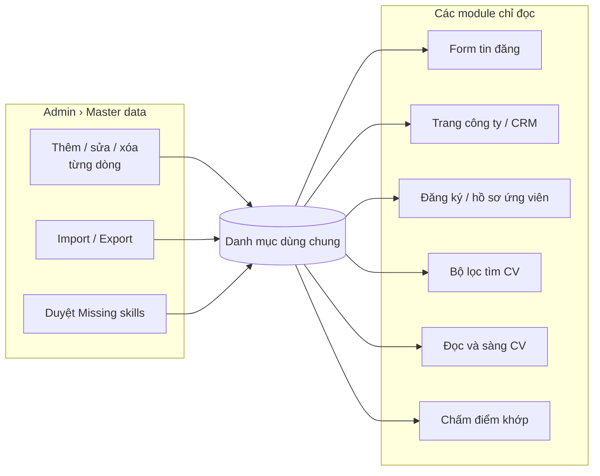
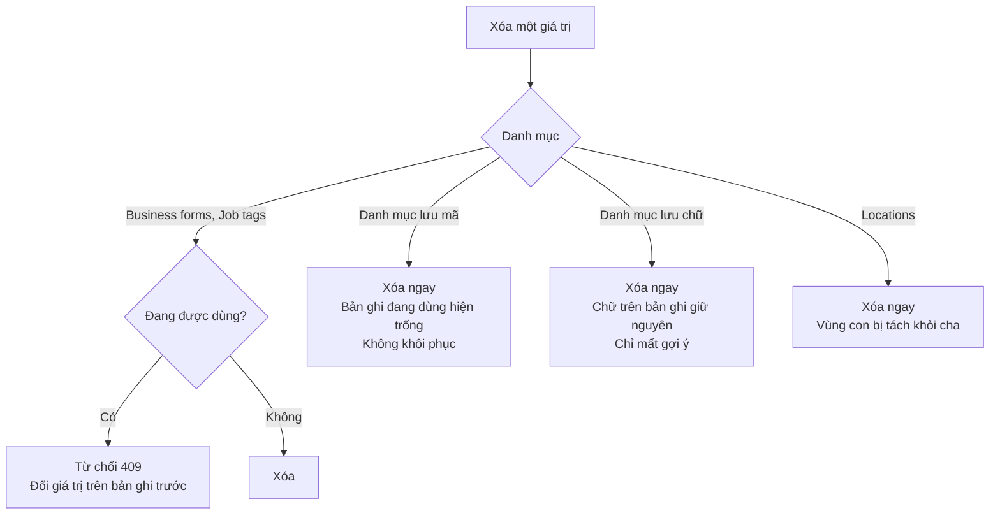
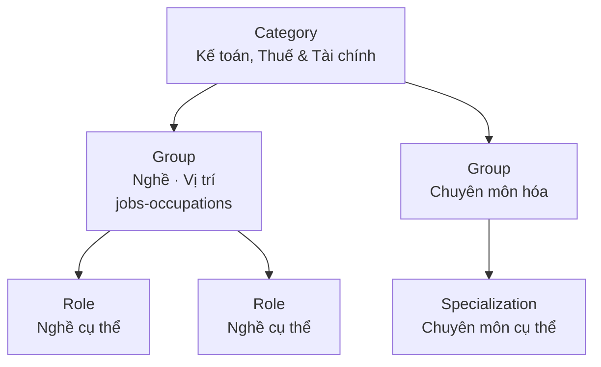
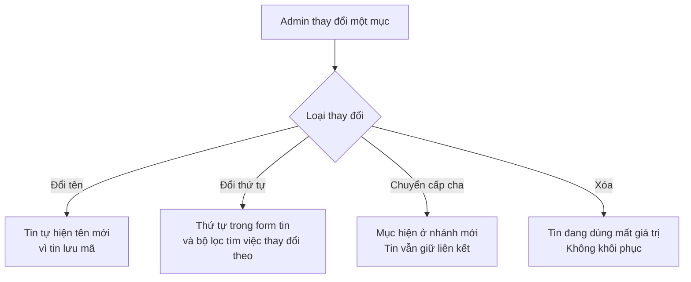
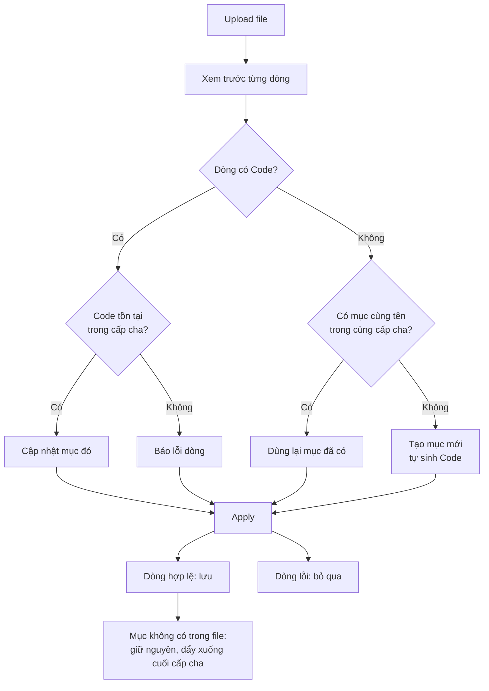
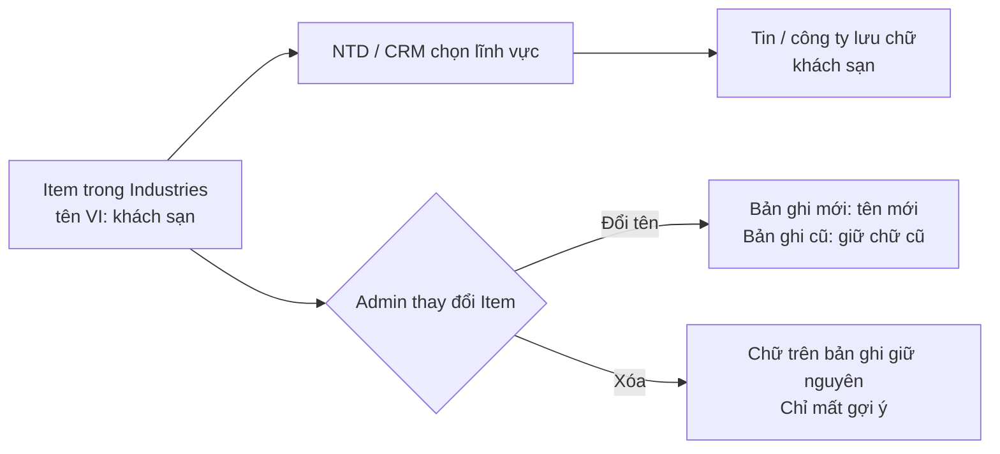
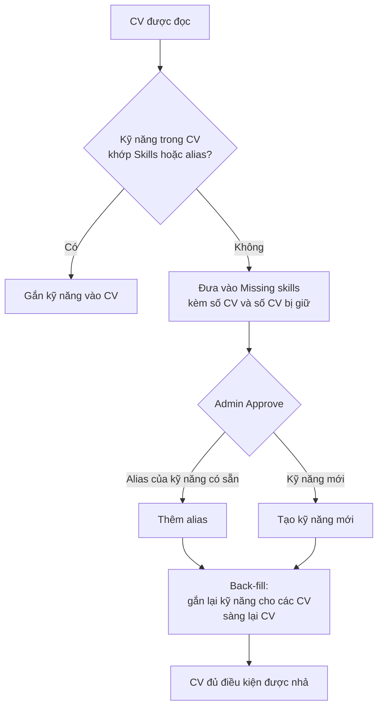
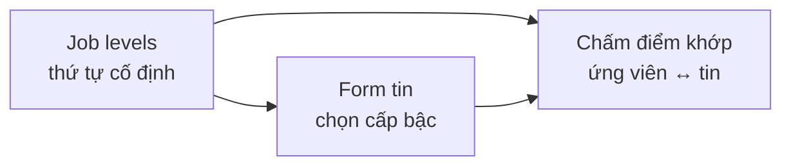
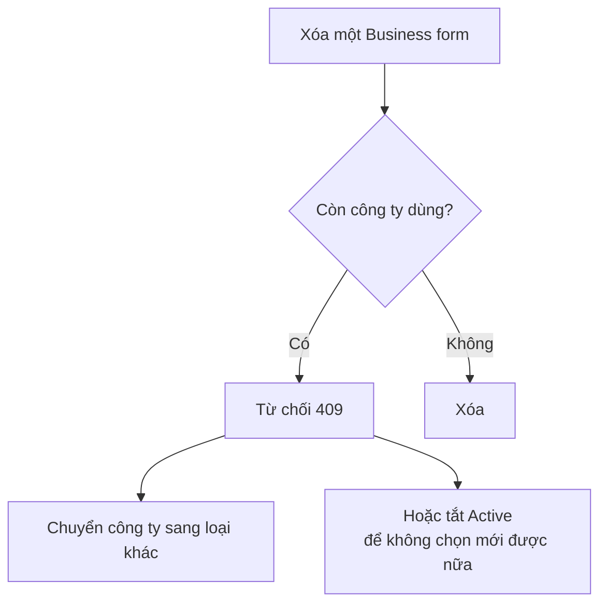
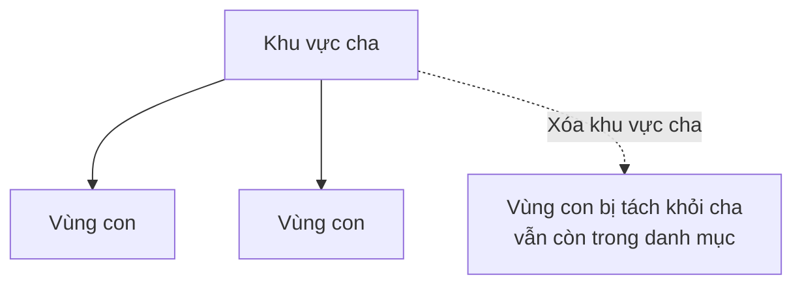

# Master Data

Phiên bản: 14/10/2026 · Người viết: Ngô Thái Nguyên (BA/QA) · Dự án: Saramin VN

| Mục | Giá trị |
| --- | --- |
| Site | Admin |
| Đường dẫn | `/system/master-data` |
| Menu | System › Master data |
| Quyền xem menu | `region:read` |

Tài liệu giải thích **logic** và **luồng hoạt động** của toàn bộ master data, để hiểu dữ liệu được tạo, thay đổi ở đâu và ảnh hưởng tới những module nào khi test. Phần đầu là logic chung cho mọi tab, sau đó là từng tab: **Logic** trước, **Flow** đi kèm khi tab đó liên quan tới nhiều module khác.

---

## 1. Logic chung

### 1.1 Master data là gì

- Master data là các **danh mục dùng chung toàn hệ thống**: ngành nghề, kỹ năng, khu vực, cấp bậc, loại hợp đồng…
- Các ô chọn ở **form tin đăng**, **hồ sơ công ty (CRM)**, **đăng ký / hồ sơ ứng viên** và **bộ lọc tìm CV** đều đọc từ đây.
- **Mọi module khác chỉ đọc.** Muốn sửa danh mục thì sửa ở Master data.

### 1.2 Tab và quyền

- Mỗi tab là một danh mục, và **mỗi danh mục có quyền riêng** (ví dụ `job_category`, `skill`, `region`), mỗi quyền gồm read / create / update / delete.
- Thiếu quyền đọc danh mục nào thì **chỉ tab đó bị ẩn**, các tab khác vẫn hiện bình thường.
- Mục menu Master data hiện theo quyền `region:read`.

### 1.3 Trường dữ liệu

| Trường | Logic |
| --- | --- |
| Code | **Duy nhất.** Sửa được; trùng code thì bị từ chối (lỗi 409). Riêng **Business forms**: code bị khóa sau khi tạo. Với tab dạng cây (Job taxonomy, Industries), code duy nhất trong cùng cấp cha |
| Tên VI | **Bắt buộc** |
| Tên EN | Không bắt buộc trên màn hình |
| Tên KO | Chỉ có ở Skills, Business forms, Education levels, Years of experience, Nationalities |

### 1.4 Thứ tự hiển thị

- Hầu hết danh mục **kéo thả** để xếp thứ tự hiển thị trong ô chọn.
- Ngoại lệ: **Job levels** không kéo thả được, vì thứ tự này dùng để **chấm điểm khớp** ứng viên với tin, do hệ thống (svn-be) giữ.
- Hai người cùng xếp thứ tự một lúc: người lưu sau nhận thông báo *"This list changed while you were reordering…"* và danh sách tự tải lại.

### 1.5 Đổi tên và xóa

- **Đổi tên luôn an toàn** với các danh mục mà bản ghi lưu **mã**: tin đăng, hồ sơ trỏ theo mã nên tự hiển thị tên mới.
- **Xóa:** mọi danh mục đều có nút Xóa. Hệ thống **không kiểm tra giá trị đang được dùng**, trừ 2 danh mục (Business forms, Job tags). Kết quả khi xóa phụ thuộc cách bản ghi lưu giá trị:

| Cách bản ghi lưu giá trị | Danh mục | Khi xóa | Khi đổi tên |
| --- | --- | --- | --- |
| Lưu **mã** | Job taxonomy, Job levels, Job types, Contract types, Education levels, Years of experience, Nationalities, Countries, Company highlights | Bản ghi đang dùng **hiện trống**, không khôi phục được | Bản ghi hiện tên mới |
| Lưu **chữ** (danh mục chỉ là gợi ý) | Industries, Benefits, Skills, Company tags | Chữ đã lưu trên bản ghi **giữ nguyên**, chỉ mất gợi ý trong ô chọn | Bản ghi cũ giữ chữ cũ |
| **Chặn xóa** khi đang dùng (409) | Business forms, Job tags | Bị từ chối nếu còn công ty / tin đang dùng | Bản ghi hiện tên mới |
| Cây khu vực | Locations | Các vùng con bị **tách khỏi cha** | Bản ghi hiện tên mới |

- Không có trạng thái Active / Retired chung. Chỉ **Business forms** có công tắc **Active**.
- **Gộp 2 giá trị trùng nghĩa ở Skills:** dùng **alias**, không xóa giá trị này rồi sửa tay giá trị kia.

### 1.6 Import / Export

- Import / Export **theo từng danh mục**.
- **Danh mục dạng danh sách:** file .xlsx có sẵn dữ liệu hiện tại, gồm các cột `code`, `name_vi`, `name_en`, `name_ko`, `parent_code`, `action`.
- **Job taxonomy và Industries** dùng template dạng nhánh 9 cột (mục 2 và mục 3).
- Trước khi lưu, hệ thống **xem trước** số dòng thêm / sửa / xóa / giữ nguyên, rồi mới **Apply**.
- **Chỉ dòng ghi `delete` ở cột `action` mới bị xóa.** Dòng vắng mặt trong file được giữ nguyên.

### 1.7 Lịch sử thay đổi (Audit log)

| Thao tác | Ghi Audit log |
| --- | --- |
| Sửa đơn lẻ một dòng trên màn hình | **Không** |
| Import (`master_data.import`) | Có |
| Duyệt Missing skills (`skill_gap.adopt`) | Có |

### 1.8 Lưu ý khi test

- Ô tìm kiếm bị **xóa khi chuyển tab**. Ví dụ chữ "react" tìm ở Skills sẽ không mang sang Industries, nên bảng không bị trống vì lọc nhầm.

### 1.9 Flow tổng quan

**Khi xóa một giá trị:**

---

## 2. Danh sách tab

Thứ tự tab theo chủ đề: phân loại công việc → điều kiện một tin → mô tả ứng viên → mô tả công ty → vị trí.

| # | Tab | Gồm | Đọc ở đâu | Xóa giá trị đang dùng |
| --- | --- | --- | --- | --- |
| 1 | Job taxonomy | Cây 3 cấp: Category → Group → Role / Specialization | Form tin đăng, tìm việc, hồ sơ ứng viên | Tin đang dùng mất giá trị |
| 2 | Industries | Cây 3 cấp: Industry → Group → Item | Tin đăng, công ty | Chỉ mất gợi ý |
| 3 | Job levels | Cấp bậc | Form tin, chấm điểm khớp | Tin mất giá trị. Không kéo thả |
| 4 | Job types | Hình thức làm việc | Form tin | Tin mất giá trị |
| 5 | Contract types | Loại hợp đồng | Form tin | Tin mất giá trị |
| 6 | Benefits | Phúc lợi của một tin | Form tin | Chữ đã lưu giữ nguyên, chỉ mất gợi ý |
| 7 | Skills | Kỹ năng, có tên KO và alias | Form tin, CV, đọc CV, sàng CV | Chỉ mất gợi ý |
| 8 | Missing skills | Kỹ năng có trong CV thật nhưng danh mục chưa có | Duyệt để thêm vào Skills | — |
| 9 | Company tags | Thẻ công ty | Form New company của CRM | Chỉ mất gợi ý |
| 10 | Company highlights | 76 chip trong 12 nhóm, có ưu tiên | Dải so sánh trên trang công ty | Xóa được |
| 11 | Countries | Quốc gia | Ô quốc tịch / Country trên form công ty của CRM | Xóa được |
| 12 | Business forms | Loại hình doanh nghiệp, có công tắc Active | Ô Business form trên trang công ty | **Bị từ chối (409)** khi còn công ty dùng |
| 13 | Job tags | Thẻ góc dưới trái của thẻ tin trả phí: 9 nhóm, 68 thẻ | Ô Card tag trên form tin | **Bị từ chối (409)** khi tin đã đăng còn dùng |
| 14 | Education levels | Trình độ học vấn | Đăng ký / hồ sơ ứng viên, bộ lọc tìm CV | Xóa được |
| 15 | Years of experience | Số năm kinh nghiệm | Đăng ký / hồ sơ ứng viên, bộ lọc tìm CV | Xóa được |
| 16 | Nationalities | Quốc tịch | Đăng ký / hồ sơ ứng viên, bộ lọc tìm CV | Xóa được |
| 17 | Locations | Cây khu vực (~3.300 dòng), lọc theo cấp | Mọi ô chọn địa điểm | Vùng con bị tách khỏi cha |

---

## 3. Job taxonomy

### 3.1 Logic

**Cấu trúc 3 cấp**

| Cấp | Tên | Ví dụ |
| --- | --- | --- |
| 1 | Category (Ngành nghề) | Kế toán, Thuế & Tài chính / Accounting, Taxation, and Finance |
| 2 | Group (Nhóm) | Nghề · Vị trí / Jobs / Occupations, Chuyên môn hóa / Specialization, Workplace… |
| 3 | Role / Specialization | Nghề hoặc chuyên môn cụ thể, ví dụ Freight forwarder |

- Nghề và chuyên môn là **2 Group ngang hàng** dưới cùng 1 Category, không phải Nghề → Chuyên môn.
- Dữ liệu hiện tại: khoảng **1.075 nhánh**, **21 Category**, **56 tổ hợp Category + Group** nhưng chỉ **13 tên Group khác nhau**. Tên Group và Role lặp lại giữa các Category là bình thường.
- Code cấp 2, cấp 3 có thể trùng giữa các nhánh (ví dụ `jobs-occupations`), nên một code chỉ xác định đúng 1 mục khi **đi kèm code của cấp cha**.

**Quy tắc cấp**

- Category không có cha. Group luôn thuộc 1 Category. Role luôn thuộc 1 Group.
- Role **không được làm cha** của mục khác. Không có cấp 4.
- Ô Parent hiện **đường dẫn đầy đủ** (ví dụ "Kế toán, Thuế & Tài chính › Nghề · Vị trí"), vì tên Group lặp lại giữa nhiều Category.
- Thao tác theo cấp:

| Dòng | Thao tác |
| --- | --- |
| Category | Sửa · Thêm Group · Xóa |
| Group | Sửa · Thêm Role · Xóa |
| Role | Sửa · Xóa |

**Liên quan tới module khác**

| Module | Dùng thế nào |
| --- | --- |
| Form tin đăng (NTD và Admin) | Chọn Category trước, rồi Nghề · Vị trí và Chuyên môn thuộc Category đó |
| Tìm việc phía ứng viên ("Chọn ngành nghề") | Lọc job theo Category, Group, Role |
| Hồ sơ ứng viên / Work preference | Ứng viên chọn ngành nghề mong muốn |

**Đổi tên và xóa**

- Tin lưu **mã**, nên đổi tên an toàn: tin tự hiện tên mới.
- Xóa: tin đang dùng **mất giá trị** ("Jobs using it will show no value."), không khôi phục được.

**Import / Export (template dạng nhánh)**

- File 9 cột: 3 cột Code (không bắt buộc) và 6 cột tên (EN + VI cho 3 cấp). Mỗi dòng là **một nhánh** Category → Group → Role.
- Dòng chỉ có Category = Category chưa có Group. Dòng có Group mà không có Role = Group chưa có Role.
- Category, Group lặp lại trên nhiều dòng phải có tên EN và VI **giống hệt** nhau.
- **Thứ tự dòng trong file = thứ tự hiển thị.**
- Cách hệ thống đọc từng dòng:

| Trường hợp | Kết quả |
| --- | --- |
| Có Code | Tìm mục theo Code (kèm Code cấp cha), cập nhật tên và thứ tự |
| Code trống | Tìm mục cùng tên EN hoặc VI trong cùng cấp cha. Có thì dùng lại, không có thì tạo mới và tự sinh Code |
| Code không tồn tại | Báo lỗi dòng, không lưu |
| Code của một mục khác | Dòng **ghi đè** lên mục mang Code đó |
| Đổi Code cấp 1 / cấp 2 của một dòng | Mục được **chuyển** sang nhánh mới |
| Có Code cấp 3 nhưng thiếu Code cấp 2 / cấp 1; có Code cấp 2 nhưng thiếu Code cấp 1 | Báo lỗi dòng |
| Mục có trong hệ thống nhưng không có trong file | **Không bị xóa**, bị đẩy xuống cuối cấp cha |

- Xem trước: báo lỗi theo số dòng, chưa lưu gì. Apply: dòng hợp lệ được lưu, dòng lỗi bị bỏ qua.

### 3.2 Flow

**Cây dữ liệu (ví dụ)**

**Ảnh hưởng của thay đổi tới tin đăng**

**Import theo nhánh**

---

## 4. Industries

### 4.1 Logic

**Cấu trúc 3 cấp**

| Cấp | Tên | Ví dụ |
| --- | --- | --- |
| 1 | Industry (Ngành) | Ngành dịch vụ / Service (`service`) |
| 2 | Group (Nhóm) | Khách sạn, Du lịch và Hãng hàng không (`hotels-travel-and-airlines`) |
| 3 | Item (Mục) | khách sạn / hotel (`hotels-travel-and-airlines-hotel`) |

- Dữ liệu hiện tại: **10 Industry → 67 Group → 664 Item** (khoảng 740 mục).
- **Item không được làm cha.** Ô Parent chỉ cho chọn Industry hoặc Group, mục cấp 3 hiện mờ. Không có cấp 4.
- Ô Parent hiện **đường dẫn đầy đủ**, ví dụ "Ngành dịch vụ › Khách sạn, Du lịch và Hãng hàng không".
- Thêm mới qua nút **New ▾**: New industry, New group, New item. **New item** chọn Industry trước, rồi mới chọn Group.

**Cách lưu trên tin và công ty**

- Industries là **gợi ý**: tên VI của mục được lưu thành **chữ** trên tin đăng và công ty.
- **Xóa:** chữ đã lưu trên tin / công ty giữ nguyên, chỉ mất gợi ý trong ô chọn.
- **Đổi tên:** bản ghi mới dùng tên mới, bản ghi cũ giữ chữ cũ.

**Import / Export:** dùng template dạng nhánh 9 cột, cùng logic với Job taxonomy (mục 3.1): Industry → Group → Item.

**Chất lượng dữ liệu hiện tại**

| Hiện trạng | Số lượng |
| --- | --- |
| Item chưa có tên tiếng Anh | 109 |
| Cặp Item trùng tên trong cùng 1 Group | 6 cặp |
| Mục chưa có trên cây (ví dụ casino) | — |

### 4.2 Flow

---

## 5. Skills và Missing skills

### 5.1 Logic

**Skills**

- Danh mục kỹ năng, có tên **VI / EN / KO** và **alias** (các cách viết khác của cùng một kỹ năng). Chỉ Skills có alias.
- Dùng ở form tin, CV, và trong **đọc CV / sàng CV**: khi đọc CV, hệ thống so chữ tự do trong CV với danh sách kỹ năng và alias.
- Kỹ năng bị CV viết khác chính tả: thêm alias vào kỹ năng đó, không tạo kỹ năng mới.
- **Gộp 2 kỹ năng trùng nghĩa:** chuyển một cái thành alias của cái kia, không xóa rồi sửa tay.
- Xóa: chỉ mất gợi ý, chữ đã lưu giữ nguyên.

**Missing skills** (tab ngay sau Skills)

- Danh sách kỹ năng **xuất hiện trong CV thật** (lấy từ CV đã đọc) mà danh mục Skills **chưa có**.
- Mỗi dòng kèm **số CV** có kỹ năng đó và **số CV đang bị giữ vì thiếu điều kiện**.
- **Approve** một dòng có 2 lựa chọn:
  - thêm thành **alias** của một kỹ năng đã có, hoặc
  - tạo **kỹ năng mới**.
- Sau khi Approve (Add and back-fill), hệ thống **trong cùng một lần**:
  - gắn lại kỹ năng cho các CV liên quan,
  - **sàng lại** các CV đó,
  - nhả các CV đang bị giữ nếu nay đã đủ điều kiện.
- Thông báo kết quả: số alias thêm, số hồ sơ cập nhật, số CV được nhả.
- Duyệt Missing skills có ghi Audit log (`skill_gap.adopt`).

### 5.2 Flow

---

## 6. Job levels

### 6.1 Logic

- Danh mục cấp bậc, dùng ở form tin và trong **chấm điểm khớp** ứng viên với tin.
- **Không kéo thả được:** thứ tự cấp bậc là dữ liệu cho việc chấm điểm, do hệ thống giữ.
- Xóa: tin đang dùng mất giá trị.

### 6.2 Flow

---

## 7. Danh mục của tin đăng: Job types, Contract types, Benefits, Job tags

### 7.1 Logic

| Tab | Logic |
| --- | --- |
| **Job types** | Hình thức làm việc trên form tin. Xóa: tin đang dùng mất giá trị |
| **Contract types** | Loại hợp đồng trên form tin. Xóa: tin đang dùng mất giá trị |
| **Benefits** | Phúc lợi của một tin. Danh mục chỉ là gợi ý: xóa thì chữ đã lưu trên tin giữ nguyên |
| **Job tags** | Thẻ ở góc dưới trái của **thẻ tin trả phí**, chọn ở ô Card tag trên form tin. Gồm 9 nhóm, 68 thẻ. **Xóa bị từ chối (409)** khi tin đã đăng còn dùng: đổi thẻ hoặc gỡ tin trước |

---

## 8. Danh mục của công ty: Company tags, Company highlights, Countries, Business forms

### 8.1 Logic

| Tab | Logic |
| --- | --- |
| **Company tags** | Thẻ công ty, dùng ở form New company của CRM. Xóa: chỉ mất gợi ý |
| **Company highlights** | 76 chip trong 12 nhóm, có thứ tự ưu tiên. Hiện ở dải so sánh trên trang công ty |
| **Countries** | Quốc gia, dùng ở ô quốc tịch / Country trên form công ty của CRM |
| **Business forms** | Loại hình doanh nghiệp, dùng ở ô Business form trên trang công ty. **Code bị khóa sau khi tạo.** Có công tắc **Active** (danh mục duy nhất có). **Xóa bị từ chối (409)** khi còn công ty dùng: chuyển công ty sang loại khác, hoặc tắt Active |

### 8.2 Flow

---

## 9. Danh mục của ứng viên: Education levels, Years of experience, Nationalities

### 9.1 Logic

- Thuộc tính mô tả ứng viên, có tên **VI / EN / KO**.
- Dùng ở **đăng ký / hồ sơ ứng viên** và **bộ lọc tìm CV** của NTD.
- Xóa: hồ sơ đang dùng mất giá trị.

### 9.2 Flow

---

## 10. Locations

### 10.1 Logic

- Cây khu vực khoảng **3.300 dòng**, lọc theo cấp.
- Dùng ở **mọi ô chọn địa điểm** trên hệ thống (tin đăng, công ty, ứng viên).
- **Xóa một khu vực:** các vùng con **bị tách khỏi cha**, không bị xóa theo.

### 10.2 Flow

