# Resume Management · Create CV

Cập nhật 15/10/2026

| Mục | Giá trị |
| --- | --- |
| Site | Jobseeker site |
| Đường dẫn | `/my-profile/cv-resume` (tiêu đề trang: **Resume Management**) |
| Trang con | `/my-profile/cv/create` · `/my-profile/cv/upload` · `/my-profile/cv/:id` |

Tài liệu mô tả cách ứng viên tạo và quản lý CV trên Saramin: hai cách tạo CV, những gì mỗi CV cần để **Đạt**, cách chọn CV hiển thị cho nhà tuyển dụng (NTD), và cách CV được dùng khi nộp đơn.

---

## Tổng quan luồng

- **Một thư viện, hai loại CV:** **Saramin CV** (ứng viên soạn trong form của Saramin) và **Upload CV** (ứng viên tải file PDF / Word lên). Cả hai nằm chung một danh sách.
- **Không giới hạn số CV.** Mỗi CV là một bản riêng: tên riêng, trạng thái riêng, số đơn đã nộp riêng.
- **Mỗi CV tự khai Experienced hoặc No experience.** Khai báo này quyết định CV cần những mục nào để **Đạt**.
- **Total experience** (số năm kinh nghiệm) là con số hiển thị của từng CV, **độc lập** với khai báo Experienced / No experience.
- **Chỉ một CV được hiển thị cho NTD** tìm kiếm tại một thời điểm. Các CV khác vẫn dùng để nộp đơn bình thường.

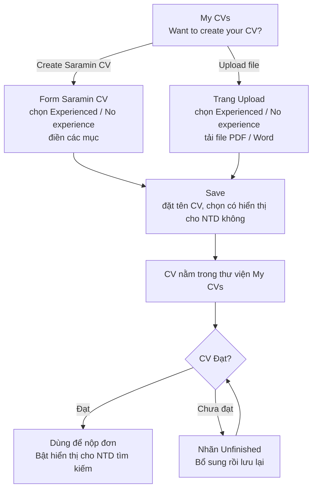

---

## 1. Trang My CVs

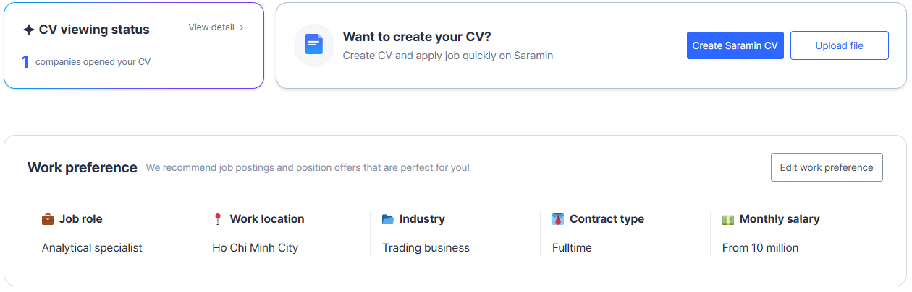

Đầu trang gồm:
- **CV viewing status:** số công ty đã mở CV của ứng viên (chi tiết ở mục 8).
- **Want to create your CV?:** hai nút **Create Saramin CV** và **Upload file**.
- **Work preference:** mong muốn công việc của ứng viên (chi tiết ở mục 7).

### CV đang hiển thị cho NTD

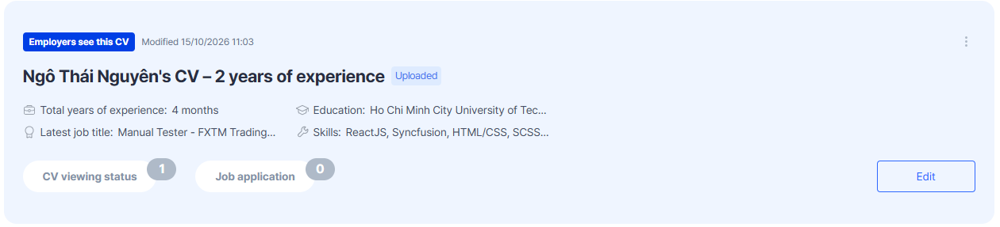

- CV đang hiển thị cho NTD nằm ở thẻ nổi bật **Employers see this CV**.
- Thẻ có 2 bộ đếm: **CV viewing status** (số công ty đã xem CV) và **Job application** (số đơn đã nộp bằng CV này).

### Danh sách CV

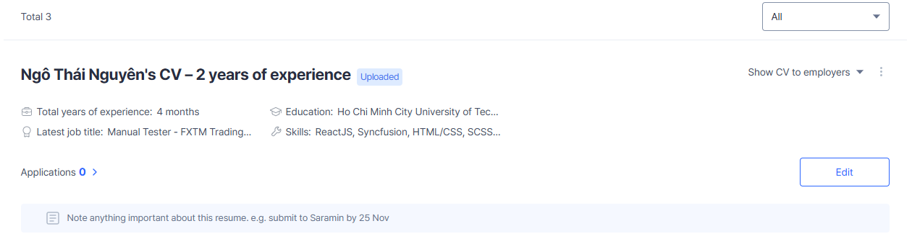

| Phần | Ý nghĩa |
| --- | --- |
| Nhãn trạng thái | **Unfinished** hoặc **Can't read**, chỉ hiện trên CV chưa đạt (mục 5) |
| Tên CV · nhãn nguồn | Bấm tên để mở trang sửa. Nhãn **Saramin CV** hoặc **Uploaded** cho biết loại CV |
| Show / Hide CV from employers | Bật / tắt hiển thị CV cho NTD (mục 6) |
| Bốn ô thông tin | **Total years of experience** · **Education** · **Latest job title** · **Skills**, lấy từ chính CV đó. Latest job title là chức danh ở công việc mới nhất trong Work experience |
| Applications N › | Số đơn đã nộp bằng CV này. Chỉ hiện trên CV đạt |
| Ghi chú | Ô ghi nhớ của ứng viên cho CV này |
| Menu ⋯ | **Download** và **Delete**. CV cuối cùng không xoá được |
| Bộ lọc | **Total {n}** · All / Saramin CV / Uploaded |

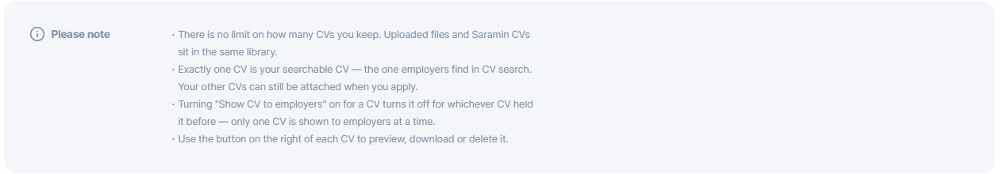

**Xoá một CV** sẽ rút các đơn đang xử lý đã nộp bằng CV đó: công ty được thông báo và không xem được CV nữa. Không hoàn tác được.

---

## 2. Tạo Saramin CV

Đường dẫn: `/my-profile/cv/create` · sửa: `/my-profile/cv/:id`

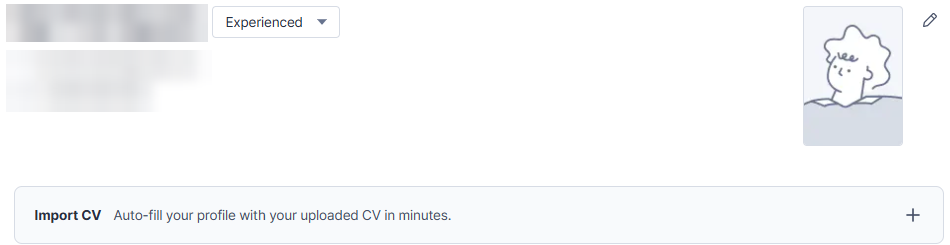

- **Experienced / No experience:** chọn ở ô cạnh tên ứng viên (mục 4).
- **Import CV:** điền sẵn form từ một CV đã tải lên, hoặc từ một file PDF (file này chỉ dùng để điền, không vào thư viện). Hệ thống hỏi trước *Import this resume over your current one?* vì import **ghi đè** nội dung đang có trong form. Chưa lưu gì cho tới khi bấm **Save**.

### Các mục của form

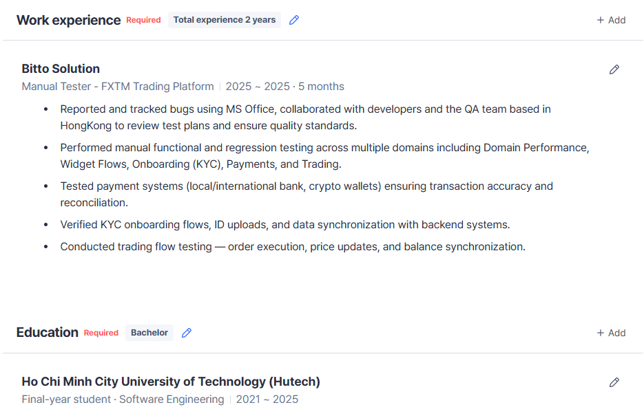

| Mục | Bắt buộc? | Ghi chú |
| --- | --- | --- |
| About | Không | Tóm tắt nghề nghiệp và mục tiêu |
| Work experience | Có, trừ khi CV khai **No experience** | Có chip **Total experience** và bút chì để sửa (mục 4). Khai No experience thì mục Education lên trên Work experience |
| Education | **Luôn bắt buộc** | Chọn mục nào là bậc học cao nhất |
| Highlight projects | Không | — |
| Skills | Không | Tối đa 20 kỹ năng |
| Foreign languages | Không | — |
| Certificates · Awards · Activities · References | Không | Tuỳ chọn, thêm bằng nút + ở thanh CV completeness |

### Thanh CV completeness

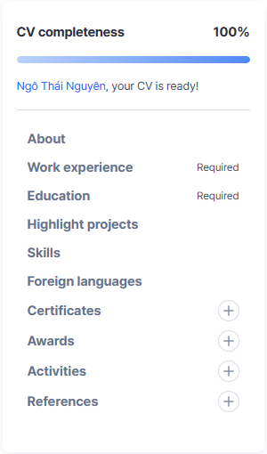

- **100% nghĩa là CV Đạt.** Thanh chỉ tính các mục bắt buộc (mục 5).
- Các mục còn lại là danh sách để bấm nhảy tới, không làm đổi con số %.

### Lưu CV

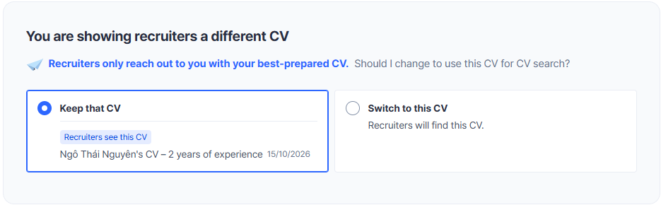

- Khi lưu, ứng viên **bắt buộc chọn** có hiển thị CV này cho NTD không:
  - **Show this CV to recruiters** / **Show no CV**, hoặc
  - khi đã có CV khác đang hiển thị: **Keep that CV** / **Switch to this CV**.
- **CV Title** để trống thì hệ thống tự đặt: *{tên}'s CV – {số năm} of experience*, hoặc *– No experience yet* khi CV chưa có số năm kinh nghiệm. Số năm lấy từ **Total experience của chính CV đó**.
- **Resume preview:** xem trước CV với nội dung đang soạn.

**Không lưu được khi:**
- Thiếu mục bắt buộc: *Please fill in {sections} before you finish.*
- Còn mục đang mở sửa chưa lưu: *Please save everything you are still editing before you finish.*
- Chưa chọn có hiển thị CV hay không: *Please choose whether to show your CV to recruiters.*

---

## 3. Tải CV lên (Upload CV)

Đường dẫn: `/my-profile/cv/upload`

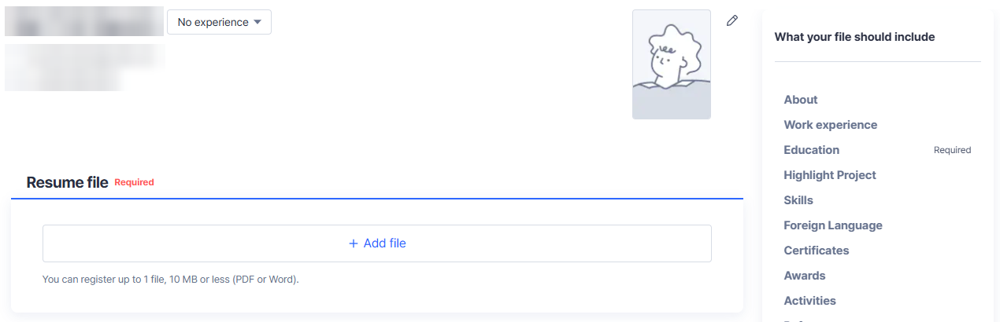

- Trang Upload **chỉ có tải file**: ứng viên chọn Experienced / No experience và tải file vào ô **Resume file**.
- **File nhận:** PDF hoặc Word, tối đa **10 MB**, 1 file. File sai định dạng hoặc quá dung lượng: *The file must be a PDF or Word document, no larger than 10 MB.*
- Khung **What your file should include** bên phải nhắc file cần có những mục nào, theo khai báo:
  - **Experienced:** Work experience và Education ghi Required.
  - **No experience:** chỉ Education ghi Required.

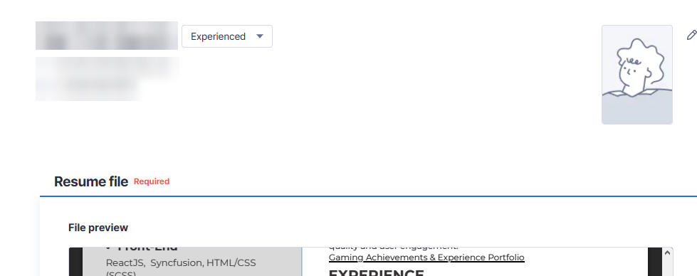

- **CV được tạo ngay khi file tải xong.** Hệ thống đọc (parse) file để lấy các mục: kinh nghiệm, học vấn, kỹ năng…
- Bấm **Save** để đặt tên CV, chọn Experienced / No experience và chọn có hiển thị CV cho NTD không (như Saramin CV).
- Total experience của Upload CV lấy từ kinh nghiệm đọc được trong file.

### So sánh hai loại CV

| | Saramin CV | Upload CV |
| --- | --- | --- |
| Nội dung | Ứng viên tự gõ trong form; hệ thống tạo ra file PDF | File gốc của ứng viên; hệ thống đọc file để lấy các mục |
| File nhận | — | PDF, Word, ≤ 10 MB |
| Điền sẵn | **Import CV** từ CV đã tải lên hoặc file PDF | Không cần, file tự được đọc |
| Chấm Đạt | Ngay từ các mục đã nhập | Từ kết quả đọc file |
| Total experience | Sửa ở chip Total experience | Lấy từ file |

---

## 4. Experienced / No experience và Total experience

Đây là **hai thứ khác nhau, độc lập với nhau**.

| | Experienced / No experience | Total experience |
| --- | --- | --- |
| Là gì | Lời khai "tôi đã đi làm chưa" | Số năm + tháng kinh nghiệm của CV |
| Dùng để | **Chỉ** để chấm CV Đạt: có cần mục Work experience hay không | **Hiển thị** kinh nghiệm của ứng viên ở mọi nơi |
| Có hiển thị như kinh nghiệm không? | **Không** | Có |
| Ảnh hưởng CV Đạt? | Có | Không |

Ví dụ: CV có Total experience 11 năm nhưng khai No experience vẫn hiển thị **11 năm**.

### Cách tính Total experience

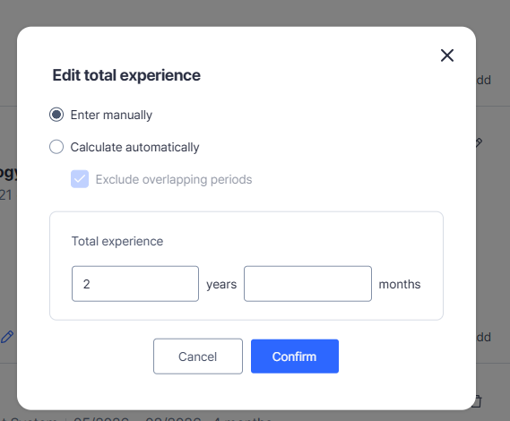

| Tình huống | Total experience |
| --- | --- |
| Onboarding: ô **"Số năm kinh nghiệm của bạn"** | Ứng viên tự gõ số năm |
| CV đầu tiên | Lấy số năm ở Onboarding làm mặc định |
| Bỏ qua Onboarding | Hiển thị **"--"** (chưa có thông tin) |
| Sửa trên một CV | Chỉ đổi CV đó. Con số mới thành mặc định cho các CV tạo sau |
| **Enter manually** | Đúng con số ứng viên gõ (năm và tháng; tháng từ 0 đến 11) |
| **Calculate automatically** | Cộng thời gian các công việc trong Work experience |
| Exclude overlapping periods: **bật** | Khoảng thời gian trùng chỉ tính 1 lần. Ví dụ 2 công việc 3 tháng làm song song → **3 tháng** |
| Exclude overlapping periods: **tắt** | Cộng dồn tất cả. Ví dụ trên → **6 tháng** |

**Phía NTD** (Talent Pool, xem chi tiết CV): số năm kinh nghiệm hiển thị kèm tooltip, ghi rõ con số do ứng viên tự khai và có thể khác với kinh nghiệm thực tế liệt kê trong CV.

---

## 5. CV Đạt và chưa đạt

### Tiêu chí Đạt

| CV khai | Bắt buộc | CV completeness |
| --- | --- | --- |
| **No experience** | Ít nhất 1 Education | Có Education → 100% |
| **Experienced** | Ít nhất 1 Work experience **và** 1 Education | Mỗi mục 50%, đủ cả hai → 100% |

- Skills, Highlight projects và Total experience **không** ảnh hưởng tới kết quả Đạt.
- Đổi Experienced ↔ No experience thì CV được chấm lại ngay khi lưu. Ví dụ CV đang Unfinished vì thiếu Work experience có thể thành Đạt khi đổi sang No experience, nếu đã có Education.

### Ứng viên thấy gì

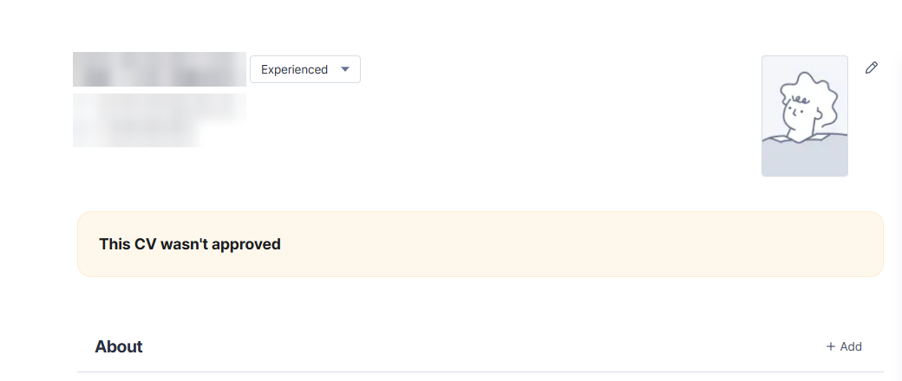

| Trạng thái | Khi nào | Nhãn trước tên CV | Nút trên dòng |
| --- | --- | --- | --- |
| **Đạt** | Đủ mục bắt buộc | Không có nhãn | Edit |
| **Chưa đủ** | Thiếu mục bắt buộc (Saramin CV), hoặc file đã đọc nhưng thiếu mục (kể cả file scan không đọc ra chữ) | **Unfinished** + thanh Completion N% | Complete CV |
| **Bị từ chối** | Bộ phận kiểm duyệt của Saramin từ chối CV | **Can't read**; rê chuột lên nhãn để xem lời nhắn | Complete CV. Trang sửa có khung **This CV wasn't approved** kèm lời nhắn |
| **Đang đọc file** | File tải lên chưa đọc xong | Không có nhãn | Edit |

CV chưa đạt **không dùng để nộp đơn được** và **không bật hiển thị cho NTD được** (mục 6, mục 9).

---

## 6. Hiển thị CV cho nhà tuyển dụng (Show CV to employers)

| Tình huống | Điều gì xảy ra |
| --- | --- |
| Bật trên một CV | Chọn **Show CV to employers** ở dòng CV. CV đó lên thẻ **Employers see this CV**; CV đang hiển thị trước đó tự tắt. Không hỏi xác nhận |
| Tắt | Hệ thống hỏi trước: *If you're job hunting right now, keep offers open too*, với 2 lựa chọn **Keep my CV visible** (mặc định) và **Hide my CV** |
| Không CV nào đang hiển thị | Khung **CV hidden from employers**, chọn CV ở ô Choose a CV rồi bấm **Let employers find me** |
| File tải lên đầu tiên | Nếu ứng viên chưa có CV nào đang hiển thị, file tải lên đầu tiên đọc xong được tự đặt làm CV hiển thị |
| Phía NTD | Ứng viên có CV đang hiển thị thì xuất hiện trong Talent Pool của NTD. Tên và thông tin liên hệ được che tới khi NTD mở khoá (xem trang Talent Pool) |

- **Chỉ một CV hiển thị tại một thời điểm.**
- Bật một CV hiển thị cũng cập nhật hồ sơ của ứng viên theo nội dung CV đó.

---

## 7. Work preference

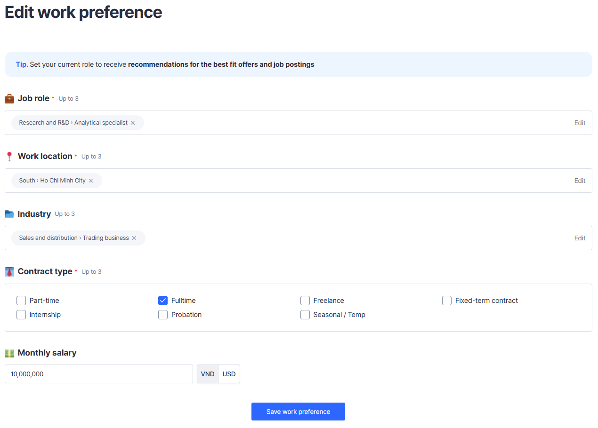

- Bấm **Edit work preference** trên trang My CVs.
- Dùng để gợi ý tin tuyển dụng và lời mời phù hợp. **Độc lập với CV.**

| Trường | Bắt buộc | Tối đa | Chọn từ |
| --- | --- | --- | --- |
| Job role | Có | 3 | Danh mục ngành nghề (Ngành › Vị trí) |
| Work location | Có | 3 | North / Central / South › tỉnh / thành phố |
| Industry | Không | 3 | Danh mục lĩnh vực (3 cấp) |
| Contract type | Có | 3 | Fulltime, Part-time, Freelance, Fixed-term contract, Internship, Probation, Seasonal / Temp |
| Monthly salary | Không | — | Số tiền, VND hoặc USD |

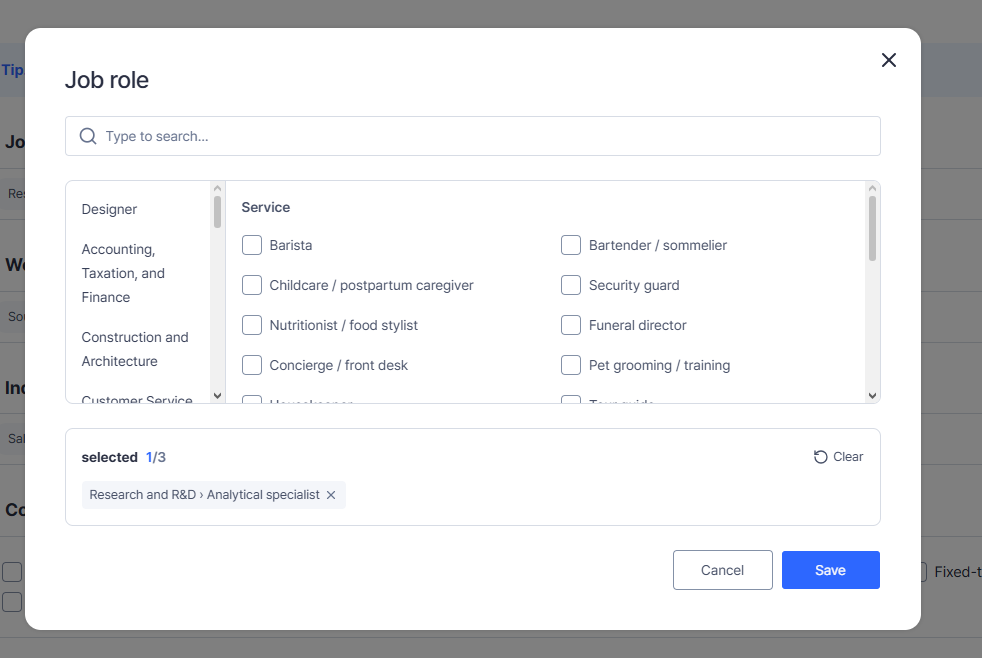

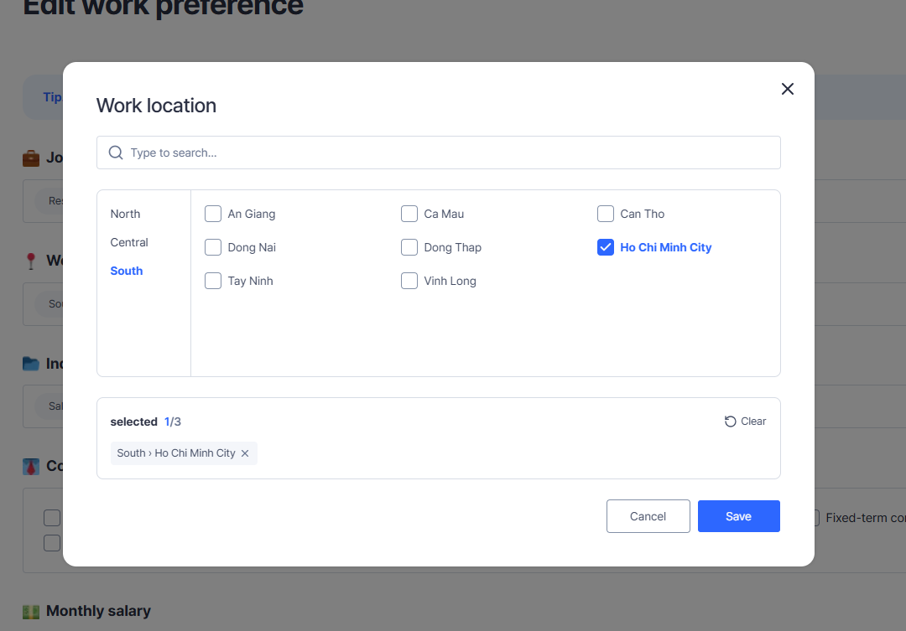

---

## 8. CV viewing status

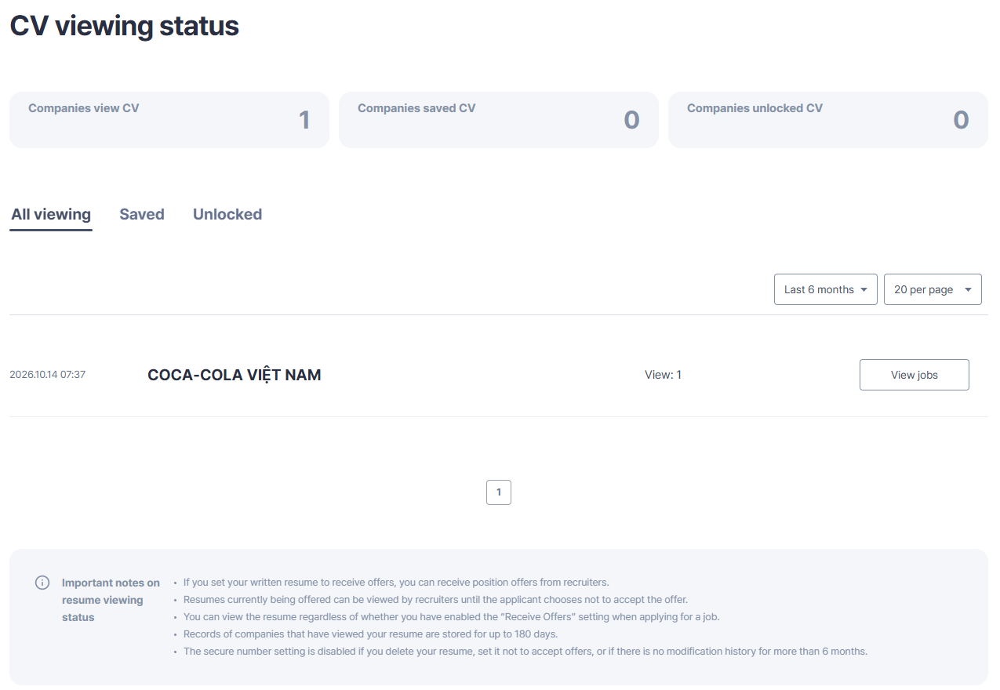

- Ứng viên xem những công ty đã tương tác với CV của mình trong Talent Pool.
- 3 bộ đếm và 3 tab: **Companies view CV** (đã xem) · **Companies saved CV** (đã lưu) · **Companies unlocked CV** (đã mở khoá thông tin liên hệ).
- Lịch sử lưu tối đa **180 ngày**. Lọc theo thời gian (ví dụ Last 6 months).

---

## 9. Dùng CV khi nộp đơn

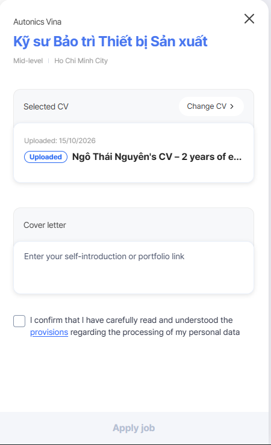

- Bấm **Apply** trên trang job, khung nộp đơn hiện CV đang chọn (**Selected CV**), ô **Cover letter** và ô xác nhận đã đọc quy định xử lý dữ liệu cá nhân. Nút **Apply job** chỉ bấm được khi đã tick ô xác nhận.

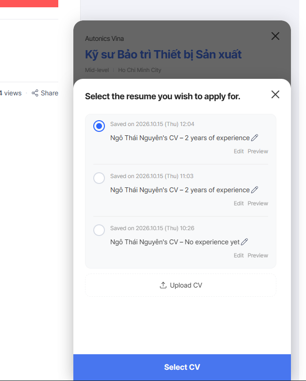

- **Change CV** mở danh sách mọi CV của ứng viên, kể cả CV không hiển thị cho NTD. Mỗi CV có Edit và Preview.
- CV **Unfinished** bị làm mờ, không chọn được.
- **Upload CV** ở cuối danh sách: chuyển sang trang Upload, tải xong quay lại job.
- Mỗi ứng viên **chỉ nộp được 1 lần vào mỗi job**. Bấm Apply ở job đã nộp sẽ hiện thông báo *You've applied for this job* kèm nút **Go to My applications**.

---

## 10. Giới hạn

| Giới hạn | Giá trị |
| --- | --- |
| Số CV mỗi ứng viên | Không giới hạn |
| Định dạng file | PDF hoặc Word. Import CV chỉ nhận PDF |
| Dung lượng file | Tối đa 10 MB |
| Số CV hiển thị cho NTD | 1 |
| Kỹ năng mỗi CV | Tối đa 20 |
