# Resume Management · CV review

Cập nhật 15/10/2026

| Mục | Giá trị |
| --- | --- |
| Site | Admin |
| Màn hình | **CV review** (`/recruitment/cv-review`) · **Applications** (`/recruitment/applications`) |
| Ai dùng | Admin, Operator, CS. Cần quyền xem CV review và quyền duyệt CV |

Tài liệu hướng dẫn cách Saramin kiểm duyệt CV trước khi gửi tới nhà tuyển dụng (NTD): mỗi trạng thái nghĩa là gì, trạng thái nào làm được thao tác nào, và mỗi thao tác thay đổi những gì cho Admin, NTD và ứng viên.

---

## Tổng quan

- **Mọi CV đều được kiểm tra trước khi tới NTD.** CV đạt thì tự động gửi đi. CV đáng ngờ (không đọc được, thiếu thông tin) vào **hàng đợi chờ người duyệt**.
- **Duyệt CV, không duyệt từng đơn.** Mỗi quyết định áp dụng cho **mọi hồ sơ dùng cùng phiên bản CV** đó, ở mọi công ty.
- **Đơn gắn CV đang chờ duyệt bị giữ ở Not sent, vô thời hạn.** Không có cơ chế tự gửi sau một khoảng thời gian; chỉ người duyệt mới giải phóng được. Hàng đợi bị bỏ quên nghĩa là ứng viên và NTD đều đang chờ mà không biết.
- **Quyết định duyệt / từ chối là chung cuộc.** Không gỡ được. Muốn xét lại, ứng viên cần tải lên CV khác hoặc phiên bản mới.
- Hồ sơ đã gửi tới NTD có thể kết thúc sớm theo 2 cách: **Recall CV** (CV bị từ chối sau khi đã gửi) và **Withdraw application** (ứng viên xin rút đơn, *đang triển khai*).

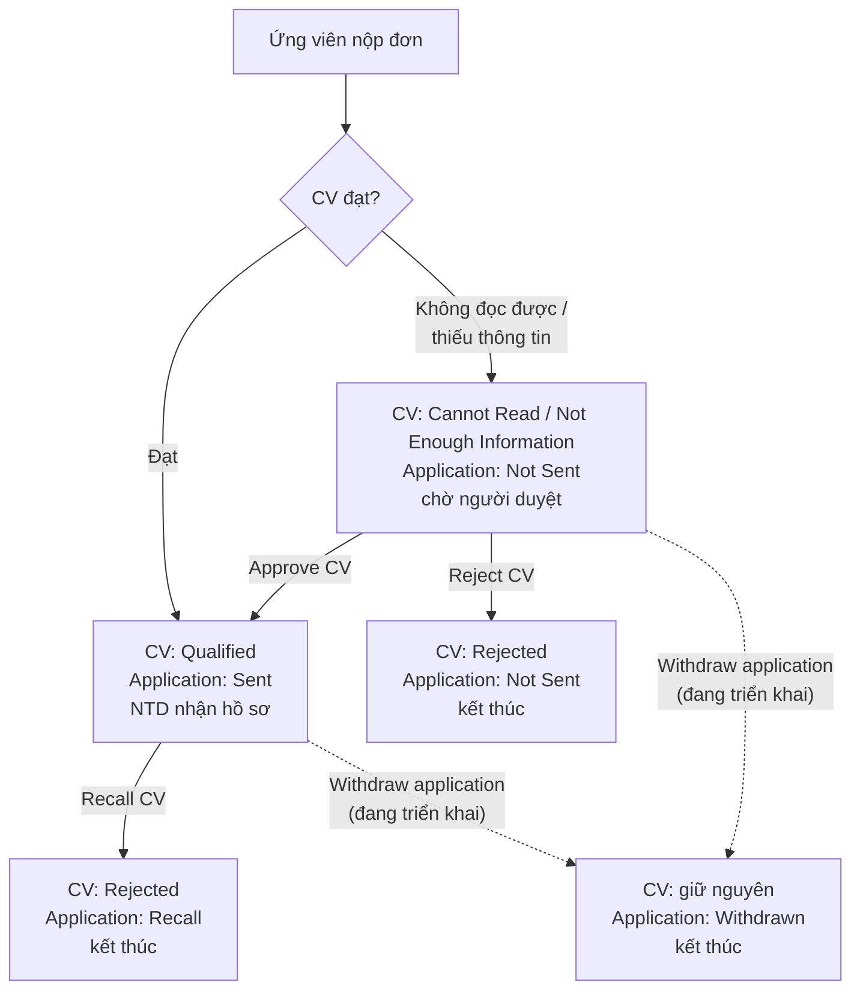

---

## 1. Các trạng thái

Mỗi hồ sơ ứng tuyển có 2 trạng thái trên Admin: **CV Status** (kết quả kiểm tra CV) và **Application Status** (hồ sơ đã tới NTD hay chưa).

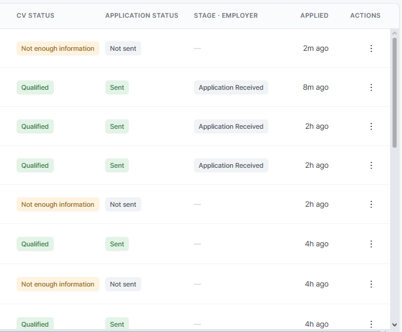

### 1.1 CV Status

| CV Status | Nghĩa là | Vì sao có | Thao tác được |
| --- | --- | --- | --- |
| **Qualified** | CV đạt | Saramin CV đủ mục bắt buộc; file tải lên đọc được và đủ mục bắt buộc; hoặc được Approve | Recall CV, Withdraw application* |
| **Cannot Read** | Không đọc được | File hỏng, có mật khẩu, hoặc là bản scan không có chữ | Approve CV, Reject CV, Withdraw application* |
| **Not Enough Information** | Thiếu thông tin | Đọc được nhưng thiếu mục bắt buộc: Experienced cần Học vấn + Kinh nghiệm; No experience cần Học vấn | Approve CV, Reject CV, Withdraw application* |
| **Rejected** | Bị từ chối | Người duyệt Reject CV hoặc Recall CV | Chỉ xem |

\* Withdraw application đang triển khai (mục 7).

### 1.2 Application Status

| Application Status | Nghĩa là | NTD thấy hồ sơ? |
| --- | --- | --- |
| **Not Sent** | Hồ sơ bị giữ ở Admin: đang chờ duyệt, hoặc CV đã bị từ chối | Không |
| **Sent** | Hồ sơ đã gửi tới NTD, thẻ nằm ở cột Application Received | Có |
| **Recall** | Hồ sơ đã gửi rồi bị thu hồi vì CV bị từ chối | Thấy nhãn thu hồi, thông tin CV bị khóa |
| **Withdrawn** *(đang triển khai)* | Ứng viên xin rút đơn khỏi job, CS thực hiện | Thấy nhãn thu hồi, thông tin CV bị khóa |

**Stage · Employer** là vị trí thẻ trên Kanban của NTD (Application Received, In Process, Passed, Not This Time). Hồ sơ chưa gửi hiện "—".

### 1.3 Tổ hợp có thể gặp

| CV Status · Application Status | Nghĩa là | Ứng viên thấy |
| --- | --- | --- |
| Qualified · Sent | Đã đạt, đã gửi | Application Received trở đi |
| Cannot Read · Not Sent | Chờ duyệt | In Review |
| Not Enough Information · Not Sent | Chờ duyệt | In Review |
| Rejected · Not Sent | Bị từ chối trước khi gửi, kết thúc | Invalid Application |
| Rejected · Recall | Đã gửi rồi bị thu hồi, kết thúc | Application Withdrawn |
| Qualified / Cannot Read / Not Enough Information · Withdrawn *(đang triển khai)* | Ứng viên rút đơn, kết thúc | Application Withdrawn |

### 1.4 Thao tác theo trạng thái (menu ⋮)

| CV Status · Application Status | Thao tác |
| --- | --- |
| Cannot Read / Not Enough Information · Not Sent | View details · **Approve CV** · **Reject CV** · Withdraw application* |
| Qualified · Sent | View details · **Recall CV** · Withdraw application* |
| Rejected · Not Sent / Rejected · Recall / … · Withdrawn | Chỉ View details |

Hồ sơ đang chờ duyệt:

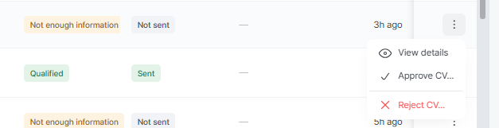

Hồ sơ đã gửi:

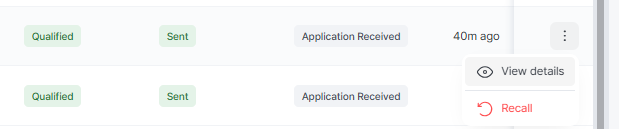

- **Reject CV** dùng cho hồ sơ **chưa gửi**. **Recall CV** dùng cho hồ sơ **đã gửi**. Cả hai đều là từ chối CV; tên thao tác theo trạng thái của hồ sơ đang thao tác.
- **Withdraw application** không đánh giá CV, chỉ rút đúng một hồ sơ theo yêu cầu ứng viên.

---

## 2. Màn CV review

Đường dẫn: `/recruitment/cv-review`. Đây là hàng đợi chính để duyệt CV.

**Logic**
- Mỗi dòng là **một CV** cần người xem, không phải một đơn ứng tuyển.
- CV tự đạt **không bao giờ vào hàng đợi**: nó được gửi đi ngay.
- CV được kiểm tra lại mỗi khi ứng viên lưu. Nhiều CV tự rời hàng đợi khi ứng viên bổ sung phần còn thiếu.
- Hệ thống không bao giờ tự từ chối. Từ chối luôn là quyết định của người duyệt.

**Màn hình**

| Phần | Chi tiết |
| --- | --- |
| Tab | **Needs review** (chờ lâu nhất lên trước) · **Approved** · **Rejected** (mới nhất lên trước). Giữ toàn bộ lịch sử |
| Overview | 4 thẻ: **Overdue · 24h** (CV chờ quá 24 giờ, mục tiêu luôn bằng 0) · **Decided · 7 days** · **Rejected · 7 days** · **Avg time to decide** |
| Cột | Candidate · CV (tên, nhãn nguồn, phiên bản) · Basic information · Work preference · Contact (luôn ẩn) · CV status · **Used to apply** · **In talent pool** · CV content · Updated · Actions |
| Tìm · Lọc | Tìm theo tên ứng viên hoặc tên file. Lọc theo CV status, Used to apply, In talent pool, lý do từ chối (tab Rejected) |
| Phiên bản | Ghi `v.N/M`. Hiện màu vàng khi đang xem bản cũ hơn bản hiện tại của ứng viên |
| Export | Có nút Export |

**Cách duyệt**
1. Ở tab **Needs review**, đọc từ trên xuống: dòng trên cùng là CV chờ lâu nhất.
2. Xem cột **Used to apply** và **In talent pool** trước khi quyết: chúng cho biết quyết định ảnh hưởng tới bao nhiêu đơn và có ảnh hưởng tới kho tìm kiếm không.
3. Bấm một dòng để mở hộp duyệt:
   - bên trái: file gốc của ứng viên,
   - bên phải: **What the scan said** (kết quả kiểm tra), **The only question** (điều cần quyết), **This decision affects** (phạm vi ảnh hưởng).
4. Chọn **Approve → sent + showing** hoặc **Reject** (mục 4, mục 5).

**Ví dụ: một lần duyệt giải phóng bao nhiêu đơn**

| Ngày | Việc xảy ra | NTD thấy gì |
| --- | --- | --- |
| 02/03 | CV của ứng viên A vào Needs review | — |
| 03/03 – 09/03 | A nộp 4 đơn vào 4 job của 3 công ty bằng CV đó | Không thấy đơn nào, cả 4 đơn ở Not sent |
| 10/03 | Người duyệt bấm Approve | Cả 4 đơn được gửi cùng lúc, mỗi công ty nhận thông báo |

---

## 3. Màn Applications

Đường dẫn: `/recruitment/applications`. Mỗi dòng là **một đơn ứng tuyển**. Dùng để xem vì sao một hồ sơ còn Not sent, và thao tác nhanh trên từng hồ sơ.

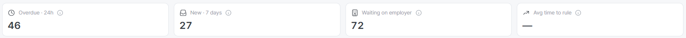

| Thẻ | Ý nghĩa |
| --- | --- |
| **Overdue · 24h** | Số đơn chờ quá 24 giờ chưa được xử lý |
| **New · 7 days** | Số đơn mới trong 7 ngày |
| **Waiting on employer** | Số đơn đã gửi, NTD chưa xử lý |
| **Avg time to rule** | Thời gian trung bình để ra quyết định |

- **Tab** (lọc theo Application Status): All · Not sent · Sent · Recall · Withdrawn *(đang triển khai)*.
- **Bộ lọc** theo CV Status: chọn được nhiều giá trị. Xem hàng đợi chờ duyệt: tab Not sent + CV Status = Cannot Read, Not Enough Information.
- **View details** mở trang chi tiết hồ sơ: thông tin ứng viên, mong muốn công việc, file CV, thông tin liên hệ và CV status của đơn.

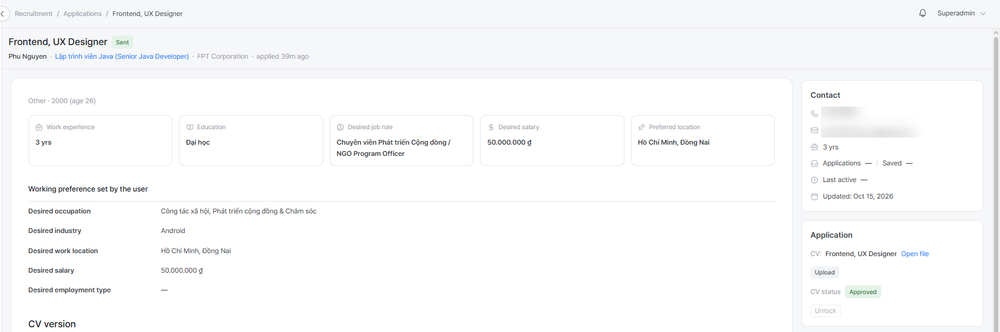

---

## 4. Approve CV

**Dùng khi:** CV đang chờ duyệt (Cannot Read / Not Enough Information · Not Sent) nhưng thực ra dùng được.

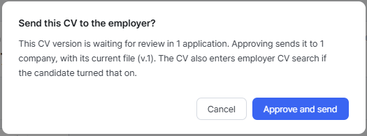

**Hộp thoại** cho biết phiên bản CV này đang chờ ở bao nhiêu đơn và sẽ gửi tới bao nhiêu công ty, kèm phiên bản file. CV cũng vào kho tìm kiếm của NTD nếu ứng viên đã bật hiển thị.

**Kết quả**

| | Sau Approve |
| --- | --- |
| Hồ sơ đang chờ dùng cùng phiên bản CV | **Qualified · Sent**, tất cả được gửi cùng lúc |
| NTD | Thẻ mới ở cột Application Received, nhận email báo đơn mới |
| Ứng viên | Application Received |
| Kho tìm kiếm | CV xuất hiện nếu ứng viên đã bật hiển thị |

---

## 5. Reject CV

**Dùng khi:** CV đang chờ duyệt và không thể gửi tới NTD.

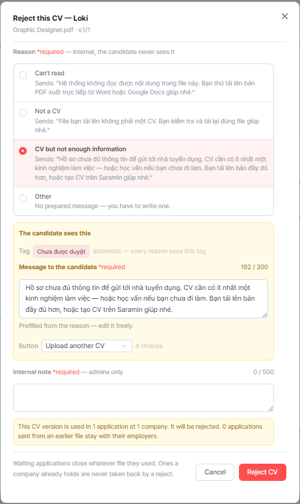

### 5.1 Các bước

1. **Chọn lý do trước.** Lý do là nội bộ, ứng viên không thấy, nhưng nó **điền sẵn lời nhắn và nút** cho ứng viên.
2. **Sửa lời nhắn** gửi ứng viên (bắt buộc, tối đa 300 ký tự).
3. **Chọn nút** hiện cho ứng viên.
4. **Nhập ghi chú nội bộ** (bắt buộc, tối đa 500 ký tự). Chỉ Admin đọc được.
5. Kiểm tra **khối ảnh hưởng** (bao nhiêu đơn bị từ chối), rồi bấm **Reject CV**.

### 5.2 Bốn lý do

| Lý do | Lời nhắn điền sẵn cho ứng viên | Nút mặc định |
| --- | --- | --- |
| **Can't read** | "Hệ thống không đọc được nội dung trong file này. Bạn thử tải lên bản PDF xuất trực tiếp từ Word hoặc Google Docs giúp nhé." | Upload another CV |
| **Not a CV** | "File bạn tải lên không phải một CV. Bạn kiểm tra và tải lại đúng file giúp nhé." | Upload another CV |
| **CV but not enough information** (chọn sẵn) | "Hồ sơ chưa đủ thông tin để gửi tới nhà tuyển dụng…" | Upload another CV |
| **Other** | Không soạn sẵn, phải tự viết | No button |

- **Nút cho ứng viên:** Upload another CV · Update profile · Contact support · No button.
- **Ứng viên thấy:** nhãn **"Chưa được duyệt"** (mọi lý do đều dùng nhãn này) và lời nhắn.
- Saramin CV (soạn trong form) chỉ nhận 2 lý do cuối: CV but not enough information, Other.

| Can't read | Not a CV | Other |
| --- | --- | --- |
| 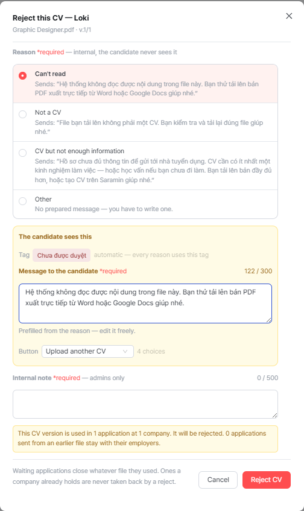 | 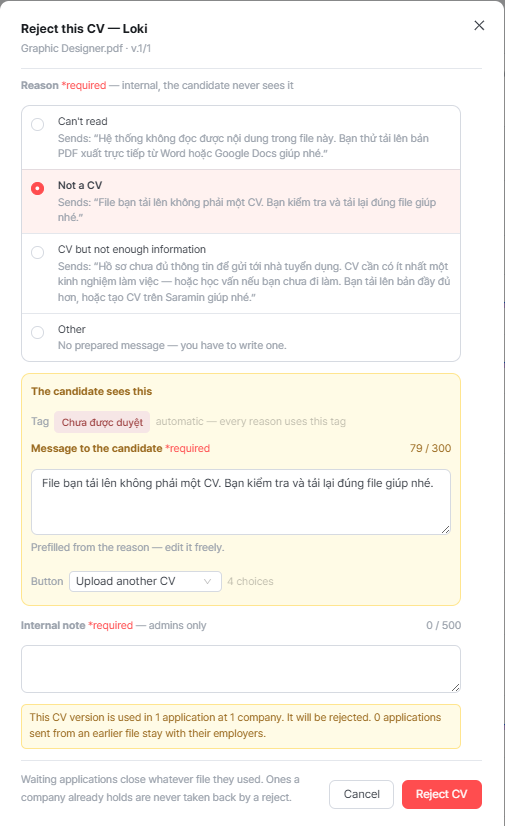 | 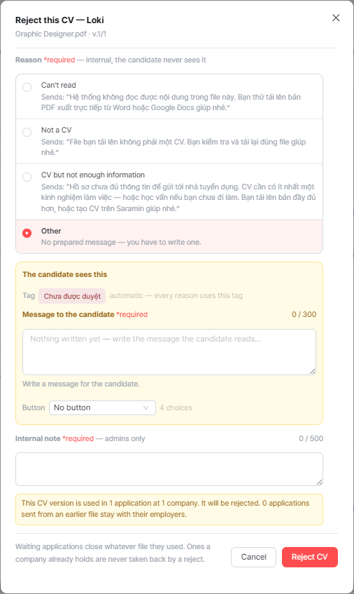 |

### 5.3 Kết quả

| | Sau Reject CV |
| --- | --- |
| Hồ sơ chưa gửi dùng cùng phiên bản CV | **Rejected · Not Sent**. NTD không bao giờ thấy |
| Hồ sơ đã gửi dùng cùng phiên bản CV | **Rejected · Recall** (xử lý như mục 6) |
| Hồ sơ dùng phiên bản CV khác | Không đổi |
| Ứng viên | **Invalid Application** (hồ sơ chưa gửi) · Application Withdrawn (hồ sơ đã gửi). Trên danh sách CV: nhãn **Can't read** cho mọi lý do, rê chuột để xem lời nhắn |

Không gửi email tự động cho ứng viên khi bị từ chối.

---

## 6. Recall CV

**Dùng khi:** CV **đã gửi** tới NTD (Qualified · Sent, ở bất kỳ cột nào) nhưng sau đó phát hiện không hợp lệ: file rác, gian lận, không phải CV.

**Ai làm:** chỉ Admin / CS.

### 6.1 Các bước

**Bước 1:** chọn lý do (Can't read · Not a CV · CV but not enough information · Other).

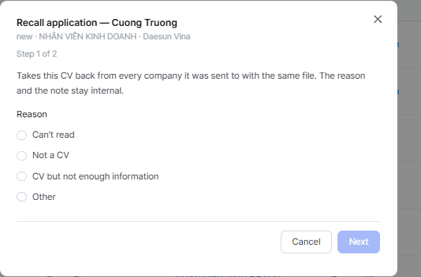

**Bước 2:** nhập ghi chú nội bộ (bắt buộc, tối đa 500 ký tự). Hộp thoại cho biết số đơn và số công ty bị ảnh hưởng. Chọn Other thì có thêm ô nhập lý do.

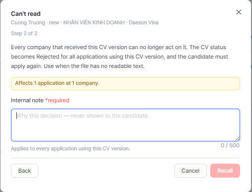

### 6.2 Kết quả

| | Sau Recall CV |
| --- | --- |
| Hồ sơ đã gửi dùng cùng phiên bản CV | **Rejected · Recall** |
| Hồ sơ chưa gửi dùng cùng phiên bản CV | **Rejected · Not Sent** |
| Hồ sơ đã Withdrawn | Không đổi |
| NTD | Nhãn thu hồi, **toàn bộ thông tin CV bị khóa** (không xem, không tải, không kéo thẻ), nhận email thông báo |
| Ứng viên | **Application Withdrawn**. Không nộp lại được vào job đó |
| Admin | Chuyển sang tab Recall. Vị trí thẻ và 2 flag Viewed / Downloaded giữ nguyên để tra cứu |

- Lý do nào cũng cho cùng kết quả. Lý do và ghi chú chỉ lưu nội bộ.
- **Không hoàn tác được.**

---

## 7. Withdraw application *(đang triển khai)*

> Tính năng này **đang được triển khai**, chưa có trên màn hình. Mô tả dưới đây là hành vi đã chốt.

**Dùng khi:** ứng viên liên hệ CS xin **rút đơn khỏi một job**. Ứng viên không tự rút được trên hệ thống.

**Ai làm:** chỉ Admin / CS.

**Áp dụng cho:** hồ sơ **đã gửi** (Qualified · Sent, bất kỳ cột nào), hoặc **đang chờ duyệt** (Cannot Read / Not Enough Information · Not Sent).

**Các bước:** chọn **Withdraw application** trong menu ⋮ → hộp thoại hiện tên công ty, tên job → nhập ghi chú nội bộ (bắt buộc: kênh và thời điểm ứng viên yêu cầu) → xác nhận. Không có danh sách lý do.

**Khác Recall thế nào**

| | Recall CV | Withdraw application |
| --- | --- | --- |
| Lý do | CV không hợp lệ | Ứng viên tự muốn rút |
| CV Status | Rejected | **Giữ nguyên** |
| Phạm vi | Mọi hồ sơ dùng cùng phiên bản CV | **Chỉ hồ sơ đang thao tác** |
| Áp dụng cho | Hồ sơ đã gửi | Hồ sơ đã gửi hoặc đang chờ duyệt |

**Kết quả**

| | Sau Withdraw application |
| --- | --- |
| Hồ sơ đang thao tác | Application Status = **Withdrawn**, CV Status giữ nguyên |
| Hồ sơ khác (kể cả cùng phiên bản CV) | Không đổi. Các quyết định sau đó trên phiên bản CV bỏ qua hồ sơ Withdrawn |
| NTD (hồ sơ đã gửi) | Nhãn **"Ứng viên đã thu hồi đơn ứng tuyển"**, toàn bộ thông tin CV bị khóa, nhận email |
| NTD (hồ sơ chưa gửi) | Không thấy gì |
| Ứng viên | **Application Withdrawn** |
| Admin | Tab Withdrawn. Hồ sơ đang chờ duyệt rời hàng đợi |

**Không hoàn tác được.**

---

## 8. Tóm tắt: mỗi thao tác, mỗi bên thấy gì

| Thao tác | Áp dụng cho | Phạm vi | Admin | NTD | Ứng viên |
| --- | --- | --- | --- | --- | --- |
| **Approve CV** | Hồ sơ chờ duyệt | Mọi hồ sơ cùng phiên bản CV đang chờ | Qualified · Sent | Nhận hồ sơ, email đơn mới | Application Received |
| **Reject CV** | Hồ sơ chờ duyệt | Mọi hồ sơ cùng phiên bản CV | Rejected · Not Sent (đã gửi: Recall) | Không thấy (đã gửi: bị khóa, email) | Invalid Application (đã gửi: Application Withdrawn) |
| **Recall CV** | Hồ sơ đã gửi | Mọi hồ sơ cùng phiên bản CV | Rejected · Recall (chưa gửi: Not Sent) | Nhãn thu hồi, CV bị khóa, email | Application Withdrawn |
| **Withdraw application** *(đang triển khai)* | Hồ sơ đã gửi hoặc chờ duyệt | Chỉ hồ sơ đó | … · Withdrawn | Đã gửi: nhãn, CV bị khóa, email | Application Withdrawn |

Mọi thao tác trên đều **không hoàn tác được**, và ứng viên **không nộp lại được** vào job đó (mỗi job chỉ nộp 1 lần).

---

## 9. Lưu ý khi sử dụng

- **Xử lý hàng đợi hằng ngày.** Thẻ **Overdue · 24h** nên luôn bằng 0. Mỗi CV chờ có thể đang giữ nhiều đơn ở nhiều công ty.
- **Reject CV: chọn lý do trước, rồi mới sửa lời nhắn.** Đổi lý do sẽ ghi đè lời nhắn đang soạn.
- **Lời nhắn soạn sẵn của "CV but not enough information"** đang ghi "ít nhất một kinh nghiệm — hoặc học vấn nếu chưa đi làm". Quy tắc đúng là **luôn cần học vấn**, cộng kinh nghiệm nếu ứng viên khai Experienced. Sửa câu trước khi gửi.
- **Approve một file không đọc được** vẫn làm CV đạt, nhưng hệ thống không lấy được chữ nào từ file, nên NTD không tìm thấy CV này khi tìm theo kỹ năng. Nên xin ứng viên một file PDF có chữ.
- **Quyết định không gỡ được.** Đừng hứa với ứng viên là "sẽ gỡ"; hướng dẫn ứng viên tải CV khác.
- **Thông tin liên hệ luôn ẩn trên màn CV review.** Mỗi lần mở danh sách hoặc mở file CV đều được ghi log.
