# Resume Management · Talent pool (phía nhà tuyển dụng)

Cập nhật 16/10/2026 · Phiên bản sau khi sửa

| Mục | Giá trị |
| --- | --- |
| Site | Employer (site công ty) |
| Đường dẫn | Thanh đầu trang › **Talent pool** (tìm kiếm) · **Candidate management** › tab **Talent pool** (folder) |
| Ai dùng | Người dùng của công ty có quyền tìm kiếm ứng viên (Search resumes) |

Tài liệu hướng dẫn NTD tìm ứng viên trong kho (Talent pool), xem CV, mở khóa, lưu vào folder và theo dõi trên bảng Kanban.

> **Cập nhật so với bản trước**
> - **Thêm mới** mục 1 đến mục 4: Tìm kiếm ứng viên, Bộ lọc, Lưu ứng viên (Save candidate), Trang CV và mở khóa.
> - Phần folder Kanban và kéo thẻ trừ credit **giữ nguyên nội dung**, chuyển xuống **mục 5**.
> - **Bỏ** phần hộp lưu trữ Archive.
> - Ảnh được cắt gọn lại; bộ lọc tách thành 2 ảnh Work preference và Candidate information.

---

## Tổng quan

- **Talent pool** là kho các ứng viên đã bật CV cho NTD tìm. NTD tìm được cả những ứng viên **chưa ứng tuyển vào công ty mình**.
- Tìm kiếm và lọc **miễn phí**, không cần gói.
- Ứng viên **chưa mở khóa**: tên, số điện thoại, email, link và file CV gốc bị che.
- **Mở khóa (Unlock)** tốn credit, **một lần, dùng vĩnh viễn** cho cả công ty.
- **Save candidate** lưu ứng viên vào folder, **không tốn credit**. Chỉ tốn khi mở khóa, hoặc khi kéo thẻ chưa mở khóa ra khỏi cột Saved.
- Ứng viên đã **nộp đơn** vào công ty: xem miễn phí trong **Candidate management › Jobs**. Tìm thấy họ trong Talent pool thì vẫn cần mở khóa.

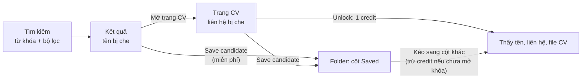

---

## 1. Tìm kiếm ứng viên

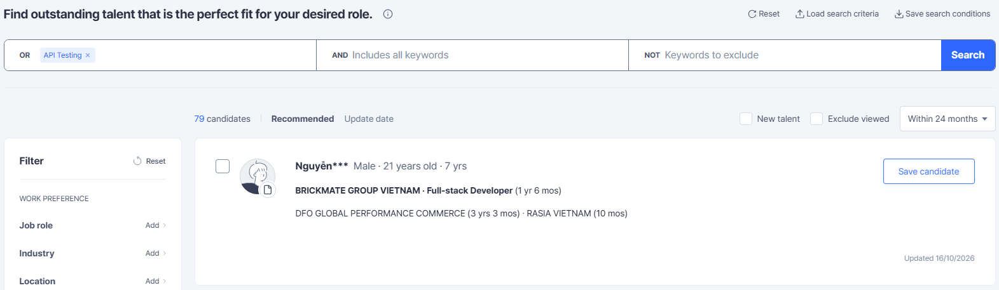

### 1.1 Thanh tìm kiếm

| Phần | Chi tiết |
| --- | --- |
| **OR** | Có ít nhất 1 từ khóa. Ô tìm kiếm chính, mở rộng kết quả |
| **AND** | Phải có tất cả từ khóa. Thu hẹp kết quả |
| **NOT** | Không được có từ khóa nào. Loại trừ |
| **Search** | Chạy tìm kiếm |
| **Reset** | Xóa toàn bộ từ khóa và bộ lọc |
| **Save search conditions** | Lưu bộ từ khóa và bộ lọc hiện tại để dùng lại |
| **Load search criteria** | Mở lại một bộ điều kiện đã lưu |

**Quy tắc từ khóa**

| Quy tắc | Chi tiết |
| --- | --- |
| Tách từ khóa | Bằng dấu phẩy hoặc xuống dòng. Dấu cách **không** tách từ khóa |
| Từ khóa nhiều chữ | Tìm đúng cụm liền nhau. `Data Mining` không khớp CV chỉ có chữ "data". Muốn tìm rời thì gõ `data, mining` |
| Dấu, hoa thường | Không phân biệt: `dieu duong` = `Điều Dưỡng` |
| Ký tự đặc biệt | Bị bỏ qua (`&`, `|`, `!`, `(`, `)`, `"`, `'`…) |
| Kết hợp 3 ô | (OR1 hoặc OR2 …) **và** AND1 **và** AND2 … **và không** NOT1 **và không** NOT2 … |

**Ví dụ:** OR = `điều dưỡng, y tá` · AND = `JCI` · NOT = `thực tập` → CV có ("điều dưỡng" hoặc "y tá"), có "JCI" và không có "thực tập".

### 1.2 Danh sách kết quả

| Phần | Chi tiết |
| --- | --- |
| **Số kết quả** | Ví dụ *79 candidates* |
| **Sắp xếp** | **Recommended** (mặc định: theo độ khớp khi có từ khóa, không có thì mới nhất) · **Update date** (ngày cập nhật CV) |
| **New talent** | Chỉ hiện ứng viên mới bật CV trong tuần |
| **Exclude viewed** | Bỏ ứng viên công ty đã xem trong 3 tháng |
| **Khoảng cập nhật** | 3 / 7 ngày; 1 / 2 / 3 / 6 / 12 / 24 tháng; hoặc bất kỳ. Mặc định *Within 24 months* |
| **Một trang** | 10 kết quả, có phân trang |
| **Manage disliked candidates** | Danh sách ứng viên công ty đã ẩn khỏi kết quả tìm kiếm |

**Thẻ kết quả**

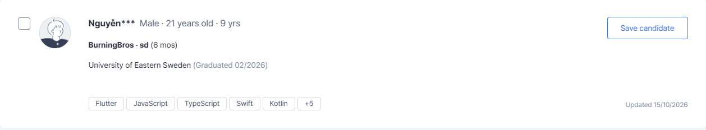

| Phần | Chi tiết |
| --- | --- |
| Tên | Đã che (ví dụ *Nguyễn\*\*\**) |
| Thông tin chung | Giới tính · tuổi · số năm kinh nghiệm |
| Công việc gần nhất | Công ty · chức danh (thời gian) |
| Công việc trước đó | Tối đa 2 công việc |
| Học vấn | Trường (năm tốt nghiệp) |
| Kỹ năng | Tối đa 5 kỹ năng, phần còn lại hiện *+N* |
| Updated | Ngày cập nhật CV |
| **Save candidate** | Lưu ứng viên vào folder (mục 3) |
| Ô chọn | Chọn nhiều ứng viên để thao tác cùng lúc |

---

## 2. Bộ lọc

Bộ lọc nằm bên trái trang kết quả, chia 2 nhóm.

**Work preference** (mong muốn công việc của ứng viên)

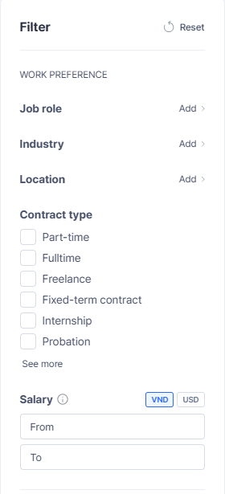

| Bộ lọc | Cách chọn |
| --- | --- |
| **Job role** | Bấm *Add* để mở hộp chọn (mục 2.1) |
| **Industry** | Bấm *Add* để mở hộp chọn |
| **Location** | Bấm *Add* để mở hộp chọn |
| **Contract type** | Tick: Part-time, Fulltime, Freelance, Fixed-term contract, Internship, Probation… (*See more*) |
| **Salary** | Khoảng From – To, chọn VND hoặc USD |

**Candidate information** (thông tin của ứng viên)

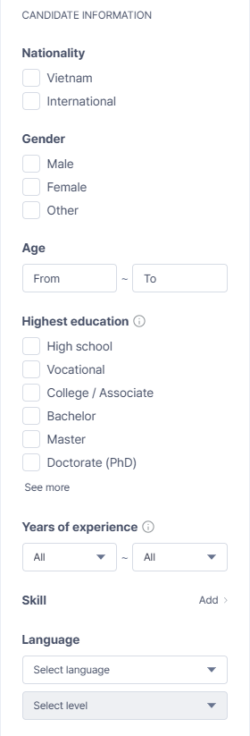

| Bộ lọc | Cách chọn |
| --- | --- |
| **Nationality** | Vietnam / International |
| **Gender** | Male / Female / Other |
| **Age** | Khoảng From – To |
| **Highest education** | High school, Vocational, College / Associate, Bachelor, Master, Doctorate (PhD)… (*See more*) |
| **Years of experience** | Khoảng từ – đến |
| **Skill** | Bấm *Add* để chọn kỹ năng |
| **Language** | Chọn ngôn ngữ và trình độ |

- **Reset** ở đầu khung Filter xóa mọi bộ lọc.

### 2.1 Hộp chọn Job role, Industry, Location

Ba hộp chọn dùng chung cách làm: ô tìm kiếm ở trên, danh sách theo cấp, khung hiện mục đã chọn, nút **Reset**, **Cancel**, **Save**.

| Hộp | Cấp | Cách chọn |
| --- | --- | --- |
| **Job role** | Nhóm nghề › Vị trí | Chọn nhóm nghề bên trái, tick vị trí bên phải. **All** chọn cả nhóm |
| **Industry** | Ngành › Nhóm › Mục | Chọn ngành, rồi nhóm, rồi tick mục. **All** chọn cả nhóm |
| **Location** | Miền › Tỉnh / thành | Chọn North / Central / South, rồi tick tỉnh / thành. **All** chọn cả miền |

| Job role | Industry | Location |
| --- | --- | --- |
| 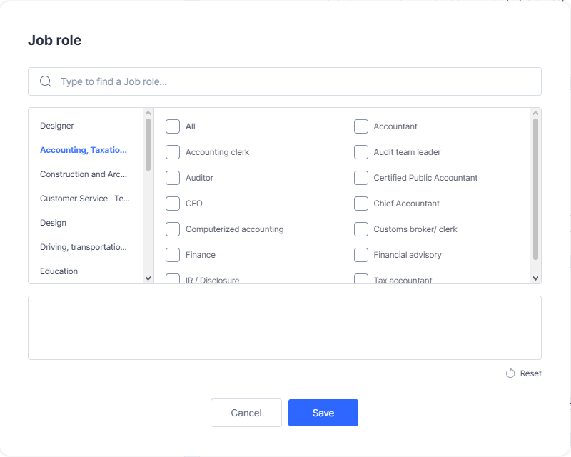 | 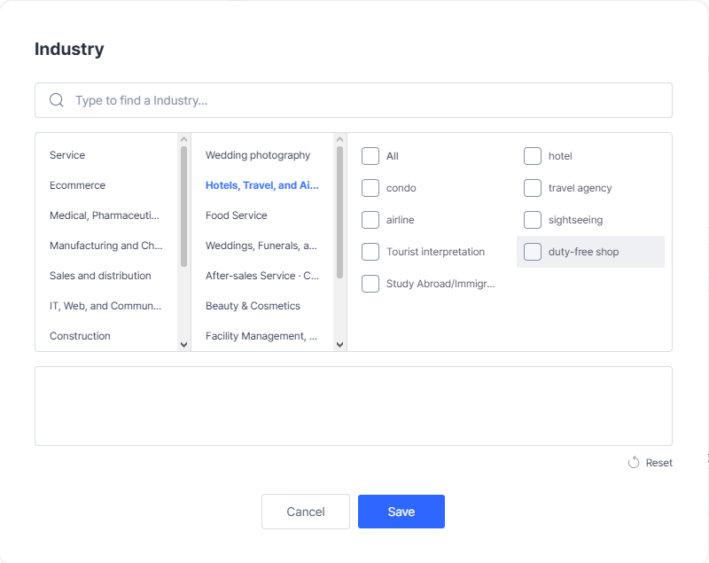 | 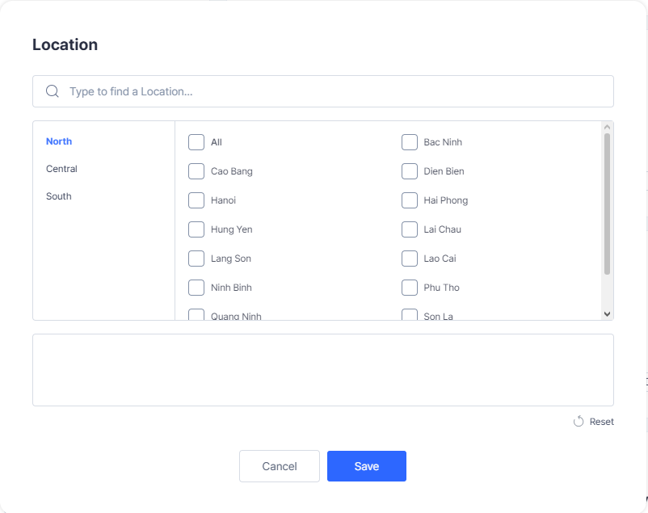 |

---

## 3. Lưu ứng viên (Save candidate)

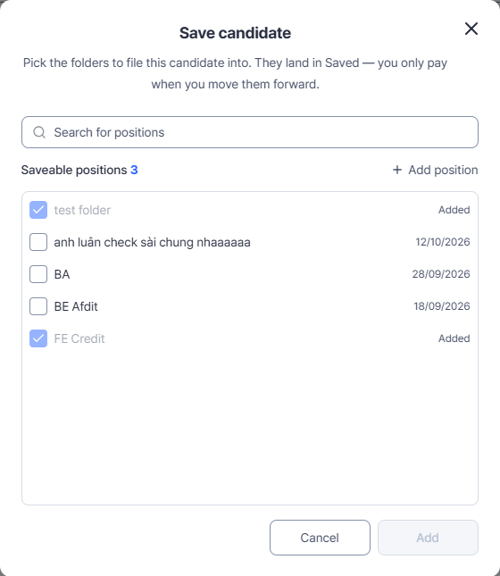

- Bấm **Save candidate** ở thẻ kết quả hoặc ở trang CV.
- Tick một hoặc nhiều **folder** để lưu ứng viên vào. Ứng viên nằm ở cột **Saved** của folder.
- **Lưu không tốn credit.** Chỉ tốn khi kéo thẻ chưa mở khóa ra khỏi Saved (mục 5.3) hoặc khi bấm Unlock.
- Folder đã có ứng viên này hiện tick mờ kèm chữ *Added*, không chọn lại được.
- **Search for positions:** tìm folder. **Add position:** tạo folder mới ngay trong hộp thoại.
- Bấm **Add** để lưu.

---

## 4. Trang CV và mở khóa

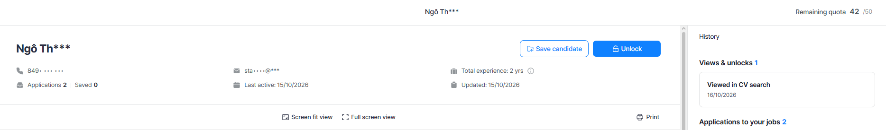

### 4.1 Trang CV

| Phần | Chi tiết |
| --- | --- |
| **Đầu trang** | Tên (đã che), số điện thoại và email (đã che), *Applications N · Saved N*, Total experience, Last active, Updated |
| **Remaining quota** | Số lượt mở khóa còn lại của công ty, ví dụ *42 / 50* |
| **Save candidate · Unlock** | Lưu vào folder · mở khóa ứng viên |
| **Tóm tắt** | Work experience, Education, Desired job role, Desired salary, Preferred location |
| **CV file** | File CV; phần thông tin liên hệ hiện *Unlock to view* khi chưa mở khóa. Có Screen fit view, Full screen view, Print |
| **History** (bên phải) | **Views & unlocks:** công ty đã xem / mở khóa ứng viên này khi nào. **Applications to your jobs:** các đơn ứng viên đã nộp vào công ty, kèm trạng thái. **Saved for positions:** các folder đang lưu ứng viên |

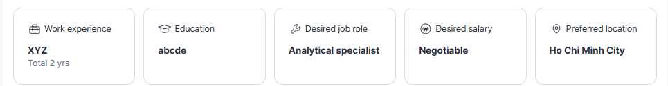

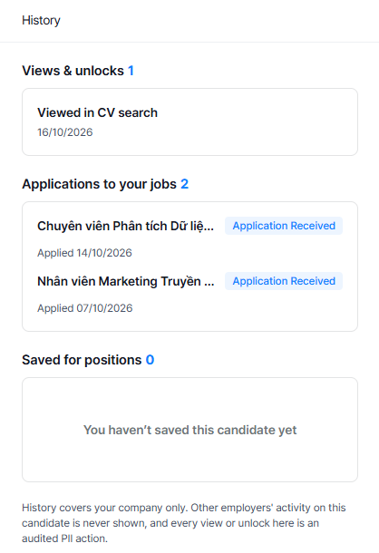

- History chỉ hiện hoạt động của **công ty mình**, không bao giờ hiện hoạt động của công ty khác.
- Mỗi lần xem hoặc mở khóa đều được ghi log.

### 4.2 Mở khóa (Unlock)

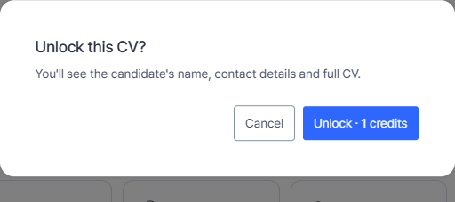

- Bấm **Unlock** → hộp thoại **"Unlock this CV?"** cho biết sẽ thấy tên, thông tin liên hệ và CV đầy đủ, kèm số credit (mặc định **1 credit**).
- Bấm **Unlock · 1 credits** để mở khóa. **Một lần, vĩnh viễn, cho cả công ty.**

### 4.3 Mức xem CV

| Mức | Khi nào | NTD thấy gì |
| --- | --- | --- |
| **Đầy đủ** | Công ty đã mở khóa ứng viên | File gốc, tên, số điện thoại, email, link |
| **Che liên hệ** | Có gói tìm kiếm CV đang chạy, hoặc còn lượt xem miễn phí | CV đã che thông tin liên hệ |
| **Khóa** | Không có gói và đã hết lượt xem miễn phí | Không xem được CV, kèm lời mời mua gói |

- Mỗi công ty có **10 lượt xem miễn phí**, tính theo số CV khác nhau. Mở lại CV đã xem không tốn lượt.

### 4.4 Khi nào không mở khóa được

| Tình huống | Kết quả |
| --- | --- |
| Hết credit | Báo hết credit, mời nạp thêm |
| Gói đã hết hạn | Báo gói hết hạn. Credit còn lại được giữ, không mất |
| Ứng viên đã xóa tài khoản | Không mở khóa được, trừ khi công ty đã mở khóa từ trước |
| Ứng viên không còn CV nào đang bật | Không mở khóa được, trừ khi đã mở khóa từ trước, hoặc ứng viên đã nộp đơn tới công ty |

---

## 5. Folder Talent pool

### 5.1 Màn hình folder

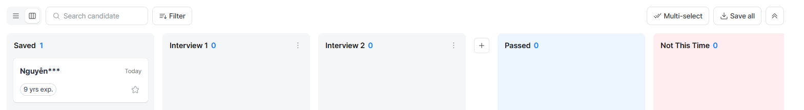

| Phần | Chi tiết |
| --- | --- |
| **Jobs / Talent pool** | Chuyển giữa ứng viên theo job (đơn ứng tuyển) và ứng viên trong Talent pool |
| **Position, candidate search** | Tìm folder hoặc ứng viên |
| **Danh sách folder** | Các folder công ty đã tạo (ví dụ test folder, BA, BE Afdit…) |
| **Search candidate** | Tìm ứng viên trong folder đang mở |
| **Filter** | Lọc ứng viên trong folder |
| **Chế độ xem** | Dạng danh sách hoặc dạng Kanban (2 biểu tượng cạnh ô tìm kiếm) |
| **Multi-select** | Chọn nhiều thẻ cùng lúc để thao tác |
| **Save all** | Tải về CV của các ứng viên |

### 5.2 Bảng Kanban của folder

**Cấu trúc cột**

| Vùng | Cột | NTD được sửa |
| --- | --- | --- |
| Cột đầu | **Saved**: ứng viên vừa lưu từ tìm kiếm | Không |
| Cột giữa | **Interview 1, Interview 2…** | Thêm (nút **+**), xóa, đổi tên. Cột mới chèn trước Passed |
| Cột cuối | **Passed** (nền xanh dương) | Không |
| Cột cuối | **Not This Time** (nền đỏ nhạt) | Không |

- Passed và Not This Time luôn nằm cuối bảng, theo thứ tự Passed rồi Not This Time. Không xóa, không đổi tên, không đổi vị trí. Vẫn kéo thẻ vào và kéo ra được.
- Folder mới mặc định: Saved · Interview 1 · Interview 2 · Passed · Not This Time.
- Số bên cạnh tên cột là số ứng viên trong cột. Cột trống hiện *"No candidates"*.

**Thẻ ứng viên**

| Phần | Ý nghĩa |
| --- | --- |
| **Tên** | Tên đã che (ví dụ *Nguyễn\*\*\**) khi chưa mở khóa; tên đầy đủ sau khi mở khóa |
| **Thời gian ở cột** | Ứng viên đã nằm ở cột hiện tại bao lâu (*Today*, số ngày). Giúp NTD biết hồ sơ nào đang bị để lâu, cần xử lý |
| **Số năm kinh nghiệm** | Ví dụ *9 yrs exp.* |
| **Ngôi sao** | Đánh dấu ứng viên yêu thích |

### 5.3 Kéo thẻ và chi phí credit

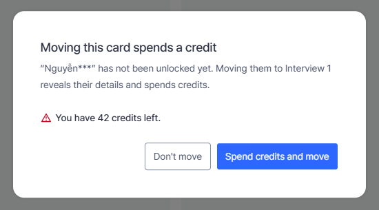

| Trường hợp | Kết quả |
| --- | --- |
| Kéo thẻ **chưa mở khóa** ra khỏi cột Saved | Hiện hộp thoại **"Moving this card spends a credit"**: cho biết ứng viên chưa được mở khóa, chuyển cột sẽ hiện thông tin và trừ credit, kèm số credit còn lại |
| Bấm **Spend credits and move** | Trừ credit, mở khóa ứng viên (thấy tên, liên hệ, file CV), thẻ chuyển sang cột mới |
| Bấm **Don't move** | Thẻ ở lại cột Saved, không trừ credit |
| Kéo thẻ **đã mở khóa** | Chuyển cột ngay, **không trừ credit** |
| Kéo thẻ giữa các cột (không phải từ Saved) | Không trừ credit |

- Mở khóa **một lần, dùng vĩnh viễn** cho cả công ty. Ứng viên đã mở khóa ở folder này thì ở folder khác cũng không bị trừ lại.
- Hết credit: hệ thống báo không đủ credit và mời mua thêm.
- Gói tìm kiếm CV đã hết hạn: không mở khóa được; credit còn lại được giữ, không mất.

---

## 6. Lưu ý khi sử dụng

- **Kéo thẻ từ Saved là trừ credit** nếu ứng viên chưa mở khóa. Đọc kỹ hộp thoại trước khi bấm Spend credits and move.
- **Tên folder và cột giữa đặt theo quy trình của công ty**; Saved, Passed, Not This Time là cột cố định, giống mọi folder và mọi job.
- **Folder Talent pool khác danh sách ứng viên của job:** ứng viên tự nộp đơn xem miễn phí ở tab **Jobs**; ứng viên NTD tự tìm và lưu thì cần mở khóa.
- **Ứng viên đã xóa tài khoản:** nếu công ty chưa mở khóa thì không mở khóa được nữa và thẻ không chuyển ra khỏi Saved được. Công ty đã mở khóa từ trước không bị ảnh hưởng.
