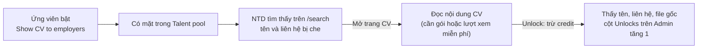

# Resume Management · Talent pool

Cập nhật 16/10/2026 · Phiên bản sau khi sửa

| Mục | Giá trị |
| --- | --- |
| Site | Admin (màn của Saramin) · Employer (kho tìm kiếm của NTD) |
| Đường dẫn | Admin: `/recruitment/talent-pool` · Employer: `/search` |
| Ai dùng | Admin: HQ Admin, VN Ops. Duyệt / từ chối cần thêm quyền duyệt CV |

Tài liệu hướng dẫn kho ứng viên (Talent pool): ai có mặt trong kho, màn Talent pool trên Admin dùng thế nào, và NTD tìm, xem, mở khóa ứng viên ra sao.

---

## Tổng quan

**Talent pool là gì**
- Là kho các ứng viên đã **bật một CV cho NTD tìm** (Show CV to employers). Không phải mọi ứng viên trong hệ thống.
- **Phía NTD** (`/search`): công ty tìm ứng viên chưa ứng tuyển vào mình. Đọc được nội dung CV, nhưng **tên, số điện thoại, email, link và file gốc bị che** cho tới khi NTD **mở khóa (unlock)**.
- **Phía Admin** (`/recruitment/talent-pool`): góc nhìn của Saramin vào cùng kho đó, **mỗi dòng một ứng viên**, kèm CV đang bật và kết quả kiểm duyệt.

**Màn Admin dùng để**
1. **Biết kho đang có ai** và CV của họ có đạt không.
2. **Kiểm soát chất lượng:** CV status, nội dung CV (số kinh nghiệm, số kỹ năng), số ứng viên cần xem lại.
3. **Theo dõi mức độ sử dụng:** số công ty đã mở khóa từng ứng viên, ứng viên lâu không cập nhật.
4. **Duyệt / từ chối CV** bằng cùng hộp thoại như Applications, hoặc chuyển sang CV review.

**Khác các màn khác thế nào**

| Màn hình | Một dòng là | Dùng để |
| --- | --- | --- |
| **CV review** | Một CV cần người duyệt | Duyệt đầy đủ: lý do, lời nhắn và nút cho ứng viên |
| **Applications** | Một đơn ứng tuyển | Theo dõi từng đơn, Approve / Reject / Recall |
| **Talent pool** | Một ứng viên đang bật CV | Xem kho NTD tìm kiếm, duyệt / từ chối CV |

**Quy tắc chính**
- **Mỗi ứng viên chỉ bật 1 CV** cho NTD tìm tại một thời điểm.
- **Ứng tuyển và Talent pool tách biệt:** đơn ứng viên tự nộp, NTD xem miễn phí trong Candidate management. NTD tự tìm trong Talent pool thì **phải mở khóa**, kể cả khi ứng viên đã nộp đơn vào chính công ty đó.
- **Mở khóa một lần, dùng vĩnh viễn**, cho cả công ty.

---

## 1. Ai có mặt trong kho

Ứng viên có mặt trong kho khi **đủ cả 3 điều kiện**:

| Điều kiện | Ai đặt | Ghi chú |
| --- | --- | --- |
| **Có 1 CV đang bật** cho NTD | Ứng viên bật **Show CV to employers**. Nếu ứng viên chưa bật CV nào, file tải lên đầu tiên được hệ thống tự bật | Admin không bật hộ được |
| **Tài khoản đang hoạt động** | Hệ thống, hoặc Admin ở màn Jobseeker users | Tài khoản bị khóa, đã xóa hoặc chưa xác thực thì rời kho ở mọi màn |
| **Hồ sơ không bị Admin ẩn** | Admin | — |

- Ứng viên bật CV nhưng chưa điền hồ sơ vẫn có mặt; các ô thông tin cá nhân để trống.
- Các trường như mức lương, số năm kinh nghiệm **không bao giờ** quyết định ai có mặt trong kho; chúng chỉ dùng để lọc.

---

## 2. Màn Talent pool trên Admin

### 2.1 Thẻ tổng quan

> **[Ảnh: Thẻ tổng quan, bộ lọc và nút trên màn Talent pool]**

| Thẻ | Ý nghĩa |
| --- | --- |
| **Searchable** | Số ứng viên có CV **Qualified** / tổng số ứng viên trong kho. Ví dụ 42 / 130 |
| **Needs a look** | Số ứng viên trong kho có CV chưa đạt, cần xem lại |
| **New · 7 days** | Số ứng viên mới vào kho trong 7 ngày |
| **Untouched 90+ days** | Số ứng viên không cập nhật CV hơn 90 ngày |

Nút **Overview** ẩn / hiện các thẻ.

### 2.2 Danh sách ứng viên

> **[Ảnh: Danh sách ứng viên trong Talent pool]**

| Cột | Ý nghĩa |
| --- | --- |
| **Candidate** | Tên ứng viên. Bấm để mở **trang hồ sơ ứng viên** ở Users › Jobseeker users (tab mới) |
| **CV** | CV đang bật: tên file, nguồn (Upload / Saramin CV), phiên bản |
| **Basic information** | Giới tính, ngày sinh, quốc tịch, học vấn cao nhất, số năm kinh nghiệm |
| **Work preference** | Nghề mong muốn, nơi làm việc, mức lương, hình thức làm việc |
| **Contact** | Email, số điện thoại (Admin thấy đầy đủ) |
| **CV status** | Chỉ hiện nhãn: Qualified / Not enough information / Cannot Read / Rejected |
| **CV search status** | **Showing** khi CV Qualified, **Hidden** với mọi trạng thái khác |
| **CV content** | Checklist các mục bắt buộc theo khai báo của CV (mục 2.3) |
| **Unlocks** | Số công ty đã mở khóa ứng viên này. CV chưa Qualified hiện "—" |
| **Updated** | Lần cập nhật CV gần nhất |
| **Actions** | Menu ⋮ (mục 2.5) |

> **[Ảnh: Cột Unlocks và Updated]**

**Tìm · Lọc · Sắp xếp · Export**
- **Tìm** theo tên, email hoặc vị trí mong muốn.
- **Lọc** theo **Status** (Approved, Pending review, Rejected, Not enough information, Can't read) và **CV search status** (Showing, Hidden). Chọn 2 bộ lọc mâu thuẫn nhau thì màn hình báo *These filters match nothing together. Clear one of them.*
- **Sắp xếp:** mặc định, hoặc theo tên A → Z / Z → A. Sắp xếp trên toàn kho, không chỉ trang đang xem.
- **Export Excel** xuất danh sách đang lọc.
- **New resume:** tạo hồ sơ thủ công từ Admin. Hồ sơ này không thuộc ứng viên nào nên **không vào kho tìm kiếm** của NTD.

### 2.3 Cột CV content: checklist mục bắt buộc

Cột CV content cho biết CV đủ hay thiếu **mục bắt buộc**, theo đúng quy tắc kiểm tra CV:
- **No experience:** cần ít nhất 1 Education.
- **Experienced:** cần ít nhất 1 Education và ít nhất 1 Work experience.

Kỹ năng, dự án, số năm kinh nghiệm **không** ảnh hưởng tới kết quả.

| Trường hợp | CV content |
| --- | --- |
| CV khai No experience | ✓ / ✗ Education |
| CV khai Experienced | ✓ / ✗ Education · ✓ / ✗ Work experience |
| CV status = Cannot Read | — |
| CV status = Rejected | — |

- ✓ màu xanh lá: đã có. ✗ màu đỏ: còn thiếu.
- Có ít nhất 1 ✗ thì CV status là **Not enough information**; đủ hết thì **Qualified**.
- CV status ở Talent pool luôn khớp với CV review và Applications.

> **[Ảnh: Cột CV status và CV content sau khi sửa]**

**Ví dụ**

| Ứng viên | CV khai | CV status | CV content |
| --- | --- | --- | --- |
| A | No experience | Qualified | ✓ Education |
| B | No experience | Not enough information | ✗ Education |
| C | Experienced | Qualified | ✓ Education · ✓ Work experience |
| D | Experienced | Not enough information | ✓ Education · ✗ Work experience |
| E | Experienced | Not enough information | ✗ Education · ✓ Work experience |
| F | Experienced | Cannot Read | — |
| G | Experienced | Rejected | — |

### 2.4 Hồ sơ ứng viên

Bấm **tên ứng viên** ở cột Candidate để mở **trang hồ sơ ứng viên** tại **Users › Jobseeker users** (`/users/jobseekers/{id}`), ở tab mới. Danh sách Talent pool giữ nguyên trang, bộ lọc và vị trí cuộn.

> **[Ảnh: Trang hồ sơ ứng viên ở Users › Jobseeker users]**

| Phần | Nội dung |
| --- | --- |
| Đầu trang | Tên, email, trạng thái tài khoản (Active…), ngày tham gia, lần hoạt động gần nhất |
| **Profile information** | Họ tên, email đăng nhập, số điện thoại, giới tính, ngày sinh, quốc tịch, ảnh |
| **Work preference** | Nhóm nghề › vị trí, nơi làm việc, lĩnh vực, loại hợp đồng, mức lương mong muốn, tổng số năm kinh nghiệm, học vấn cao nhất |
| Thao tác | Send password reset · Deactivate · Delete (theo quyền của Admin) |

- Tài khoản Admin không có quyền xem Jobseeker users: tên ứng viên hiện dạng chữ thường, không bấm được.
- **View detail ↗** trong menu ⋮ mở trang chi tiết CV (phiên bản CV mới nhất), không phải trang hồ sơ ứng viên.
- Mỗi lần mở một CV từ màn Talent pool đều được ghi log, vì CV chứa thông tin cá nhân.

### 2.5 Duyệt và từ chối CV

Talent pool dùng **cùng hộp thoại** với màn Applications và CV review.

**CV chưa đạt** (Not enough information, Cannot Read): menu ⋮ có View detail · **Approve CV** · **Reject CV** · Open in CV review.
**CV đã đạt** (Qualified): menu ⋮ có View detail · **Reject CV**.

> **[Ảnh: Menu ⋮ của CV chưa đạt và CV đã đạt]**

**Approve CV**
- Mở hộp thoại xác nhận: số hồ sơ đang chờ dùng phiên bản CV này, số công ty sẽ nhận, phiên bản file.
- Nhập **ghi chú nội bộ** (bắt buộc, tối đa 500 ký tự), rồi xác nhận.
- Kết quả: CV thành Qualified, mọi hồ sơ đang chờ dùng phiên bản CV này được gửi tới NTD, công ty nhận email.

> **[Ảnh: Hộp thoại Approve CV]**

**Reject CV**
1. **Chọn lý do** (bắt buộc): Can't read · Not a CV · CV but not enough information · Other. Lý do là nội bộ, ứng viên không thấy, nhưng nó điền sẵn lời nhắn.
2. **Phần ứng viên thấy:** tag **"Chưa được duyệt"** và **lời nhắn** cho ứng viên (bắt buộc, tối đa 300 ký tự, sửa được).
3. **Ghi chú nội bộ** (bắt buộc, tối đa 500 ký tự). Chỉ Admin đọc được.
4. Kiểm tra **khối ảnh hưởng**: số hồ sơ bị từ chối, số hồ sơ bị thu hồi, số công ty.
5. Bấm **Reject CV**.

> **[Ảnh: Hộp thoại Reject CV]**

| Lý do | Lời nhắn soạn sẵn cho ứng viên |
| --- | --- |
| Can't read | "Hệ thống không đọc được nội dung trong file này. Bạn thử tải lên bản PDF xuất trực tiếp từ Word hoặc Google Docs giúp nhé." |
| Not a CV | "File bạn tải lên không phải một CV. Bạn kiểm tra và tải lại đúng file giúp nhé." |
| CV but not enough information | "Hồ sơ chưa đủ thông tin để gửi tới nhà tuyển dụng. CV cần có học vấn, và có thêm kinh nghiệm làm việc nếu bạn đã đi làm. Bạn tải lên bản đầy đủ hơn, hoặc tạo CV trên Saramin giúp nhé." |
| Other | Không soạn sẵn, phải tự viết |

**Kết quả của Reject CV**

| Hồ sơ dùng cùng phiên bản CV | Sau Reject CV |
| --- | --- |
| Đang chờ (Not Sent) | Rejected · Not Sent. NTD không bao giờ thấy. Ứng viên thấy **Invalid Application** |
| **Đã gửi tới NTD** (Sent, bất kỳ cột nào) | **Tự động Recall**: Rejected · Recall. NTD thấy nhãn thu hồi, toàn bộ thông tin CV bị khóa, nhận email. Ứng viên thấy **Application Withdrawn** |
| Đã Withdrawn | Không đổi |

- Reject được cả CV **đã Qualified** và đã dùng để ứng tuyển. Các đơn đã gửi tới NTD được thu hồi tự động, không cần làm thêm bước Recall.
- Lượt mở khóa của các công ty trên ứng viên này được **hoàn credit**.
- Mọi quyết định **không hoàn tác được**.
- Ứng viên **không nộp lại được** vào các job đã nộp (mỗi job chỉ nộp 1 lần).

**Open in CV review:** mở đúng CV đó ở màn CV review.

--- | --- | --- |
| **View detail ↗** | Mọi dòng | Mở trang chi tiết hồ sơ |
| **Approve CV… → Qualified** | CV chưa có người quyết | CV đạt. Mọi đơn đang chờ dùng CV này được gửi, công ty nhận thông báo |
| **Reject CV… → Rejected** | CV chưa có người quyết, kể cả CV đang Qualified mà chưa ai xem | CV bị từ chối, lý do lưu là **Other**. Đơn **đang chờ** dùng phiên bản CV này: Rejected · Not Sent. Đơn **đã gửi** dùng phiên bản CV này: tự động **Recall** (NTD bị khóa thông tin CV, nhận email; ứng viên thấy Application Withdrawn). Lượt mở khóa của các công ty trên ứng viên này **được hoàn credit** |
| **Open in CV review ↗** | CV chưa đạt | Mở đúng CV đó ở màn CV review |

- Reject một CV **đã được dùng ứng tuyển và đã gửi tới NTD** thì các đơn đó **tự động bị Recall**, giống Reject CV ở CV review và Applications. Đơn đã Withdrawn không bị ảnh hưởng.
- **Quyết định không hoàn tác được.** CV đã có người duyệt hoặc từ chối thì không quyết lại được ở bất kỳ màn nào.
- Từ chối ở đây không kèm lý do cụ thể. Khi lý do quan trọng (để ứng viên biết cần sửa gì, hoặc để công ty thấy lý do trên dòng hoàn credit), hãy dùng **Open in CV review**.

---

## 3. Phía NTD: kho tìm kiếm `/search`

### 3.1 Các bước

1. Vào site công ty → **Talent pool** trên thanh đầu trang. Cần quyền **Search resumes**. Tìm kiếm không cần gói.
2. Tìm bằng **3 ô từ khóa** (mục 3.3) và bộ lọc.
3. Trên kết quả: **Save candidate** (lưu vào folder) hoặc **Dislike** (ẩn ứng viên khỏi tìm kiếm của công ty).
4. Mở trang CV → **Unlock** để xem tên, số điện thoại, email và file gốc.

### 3.2 Trang tìm kiếm

| Phần | Chi tiết |
| --- | --- |
| **Bộ lọc** | Job role · Industry · Location · Contract type · Salary (VND / USD) · Nationality · Gender · Age · Highest education · Years of experience · Skill · Language (kèm trình độ) · Last updated |
| **Sắp xếp** | **Recommended** (mặc định: theo độ khớp khi có từ khóa, không có thì mới nhất) · Ngày cập nhật mới / cũ |
| **Khoảng cập nhật** | 3 / 7 ngày; 1 / 2 / 3 / 6 / 12 / 24 tháng; hoặc bất kỳ. Mặc định 24 tháng |
| **Ô tick** | **New talent** (CV mới bật trong tuần) · **Exclude viewed** (bỏ ứng viên công ty đã xem trong 3 tháng) |
| **Một trang** | 10 kết quả |
| **Thẻ kết quả** | Tên che, giới tính, tuổi, số năm kinh nghiệm, công việc gần nhất, tối đa 2 việc cũ, trường, tối đa 5 kỹ năng, ngày cập nhật. Không có ảnh. Nút Unlock chỉ có trên trang CV |
| **Tìm kiếm đã lưu** | Lưu bộ lọc vào folder; có tab tìm theo một tin tuyển dụng của công ty |

### 3.3 Ba ô từ khóa OR · AND · NOT

| Ô | Ý nghĩa |
| --- | --- |
| **OR** | Có ít nhất 1 từ khóa. Ô tìm kiếm chính, mở rộng kết quả |
| **AND** | Phải có tất cả từ khóa. Thu hẹp kết quả |
| **NOT** | Không được có từ khóa nào. Loại trừ |

| Quy tắc | Chi tiết |
| --- | --- |
| Tách từ khóa | Bằng dấu phẩy hoặc xuống dòng. Dấu cách **không** tách từ khóa |
| Từ khóa nhiều chữ | Tìm đúng cụm liền nhau. `Data Mining` không khớp CV chỉ có chữ "data". Muốn tìm rời thì gõ `data, mining` |
| Dấu, hoa thường | Không phân biệt: `dieu duong` = `Điều Dưỡng` |
| Ký tự đặc biệt | Bị bỏ qua (`&`, `|`, `!`, `(`, `)`, `"`, `'`…). `a & b` được hiểu là cụm "a b" |
| Từ khóa trùng / rỗng | Gộp hoặc bỏ qua |
| Kết hợp 3 ô | (OR1 hoặc OR2 …) **và** AND1 **và** AND2 … **và không** NOT1 **và không** NOT2 … |

**Ví dụ:** OR = `điều dưỡng, y tá` · AND = `JCI` · NOT = `thực tập` → CV có ("điều dưỡng" hoặc "y tá"), có "JCI" và không có "thực tập".

### 3.4 Trang CV: 3 mức xem

| Mức | Khi nào | NTD thấy gì |
| --- | --- | --- |
| **Đầy đủ** | Công ty đã mở khóa ứng viên | File gốc, tên, số điện thoại, email, link |
| **Che liên hệ** | Công ty có gói tìm kiếm CV đang chạy, hoặc còn lượt xem miễn phí | Bản CV đã che thông tin liên hệ. Giới tính, tuổi vẫn hiện; ngày sinh, quốc tịch ẩn |
| **Khóa** | Không có gói và đã dùng hết lượt xem miễn phí | Không xem được CV, kèm lời mời mua gói |

Mỗi công ty có **10 lượt xem miễn phí**, tính theo số CV khác nhau. Mở lại CV đã xem không tốn lượt; công ty đang có gói thì không dùng lượt.

### 3.5 Thao tác và chi phí

| Thao tác | Chi phí | Ghi chú |
| --- | --- | --- |
| Tìm và lọc | Miễn phí | Không cần gói |
| Mở trang CV | Miễn phí (dùng lượt xem miễn phí khi không có gói) | Xem mục 3.4 |
| Save candidate | Miễn phí | Lưu vào 1 hoặc nhiều folder; thẻ vẫn bị che |
| **Unlock** | Giá mở khóa của CV, mặc định **1 credit** | Một lần, vĩnh viễn, cho cả công ty. Hết credit thì hiện hộp mời mua thêm |
| Di chuyển ứng viên đã mở khóa | Miễn phí | — |

### 3.6 Khi nào không mở khóa được

| Tình huống | Kết quả |
| --- | --- |
| Hết credit | Báo hết credit, mời nạp thêm |
| Còn credit nhưng gói đã hết hạn | Báo gói hết hạn. Credit còn lại được giữ, không mất |
| Ứng viên đã xóa tài khoản | Không mở khóa được, trừ khi công ty đã mở khóa từ trước |
| Ứng viên không còn CV nào đang bật | Không mở khóa được, trừ khi công ty đã mở khóa từ trước, hoặc ứng viên đã nộp đơn và đơn đã tới công ty này |

---

### 3.7 Folder Talent pool (Kanban)

NTD lưu ứng viên vào folder và theo dõi trên bảng Kanban, **cùng cấu trúc với Kanban của job**.

| Vùng | Cột | NTD được sửa |
| --- | --- | --- |
| Cột đầu | **Saved**: ứng viên vừa lưu từ tìm kiếm | Không |
| Cột giữa | Interview 1, Interview 2… | Thêm (nút +), xóa, đổi tên. Cột mới chèn trước Passed |
| Cột cuối | **Passed** (nền xanh dương) | Không |
| Cột cuối | **Not This Time** (nền đỏ nhạt) | Không |

- Passed và Not This Time luôn nằm cuối bảng, theo thứ tự Passed rồi Not This Time. Không xóa, không đổi tên; vẫn kéo thẻ vào và kéo ra được.
- Folder mới mặc định: Saved · Interview 1 · Interview 2 · Passed · Not This Time.
- Kéo thẻ ra khỏi Saved là mở khóa và trừ credit (trừ khi đã mở khóa từ trước).
- Thẻ trong folder **không phải đơn ứng tuyển**: kéo thẻ không đổi trạng thái gì phía ứng viên.

> **[Ảnh: Kanban folder Talent pool]**

---

## 4. Lưu ý khi sử dụng

- **"Needs a look" cao nghĩa là nhiều ứng viên trong kho có CV chưa đạt.** Ưu tiên những CV đã được dùng để ứng tuyển, vì đơn của họ đang bị giữ.
- **Chọn lý do trước, rồi mới sửa lời nhắn.** Đổi lý do sẽ ghi đè lời nhắn đang soạn.
- **Reject CV đã gửi tới NTD sẽ thu hồi đơn ở mọi công ty đang giữ phiên bản CV đó.** Đọc kỹ khối ảnh hưởng trước khi bấm.
- **Ghi chú nội bộ luôn bắt buộc:** ghi rõ vì sao quyết định và đã thấy gì trong file.
- **Approve một file không đọc được** vẫn làm CV đạt, nhưng NTD không tìm thấy CV đó khi tìm theo kỹ năng, vì hệ thống không lấy được chữ từ file.
- **Ứng viên đã xóa tài khoản:** công ty chưa mở khóa thì không mở khóa được nữa; thẻ đang lưu không chuyển ra khỏi cột Saved được. Công ty đã mở khóa từ trước không bị ảnh hưởng.
