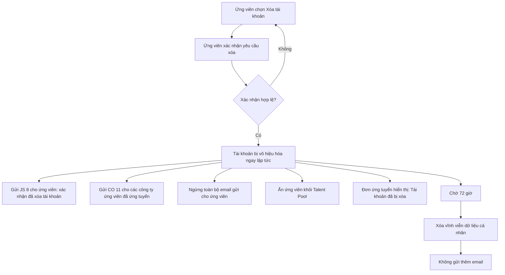
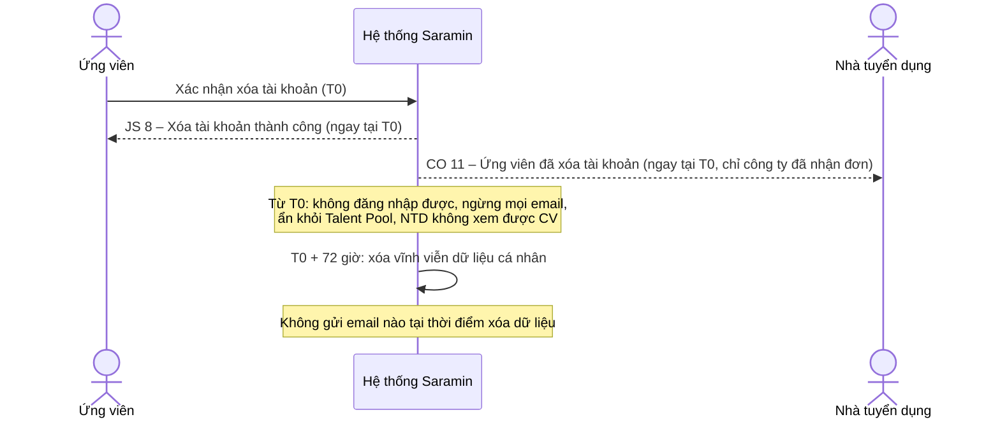
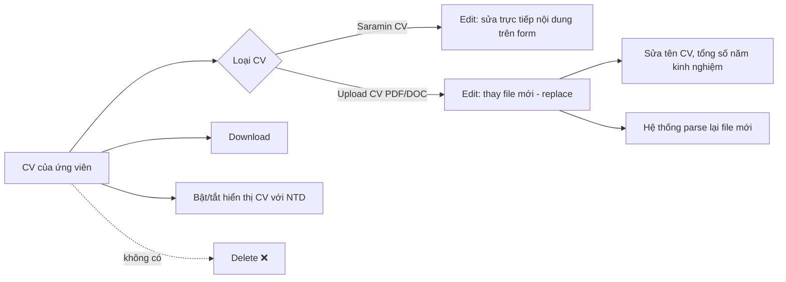
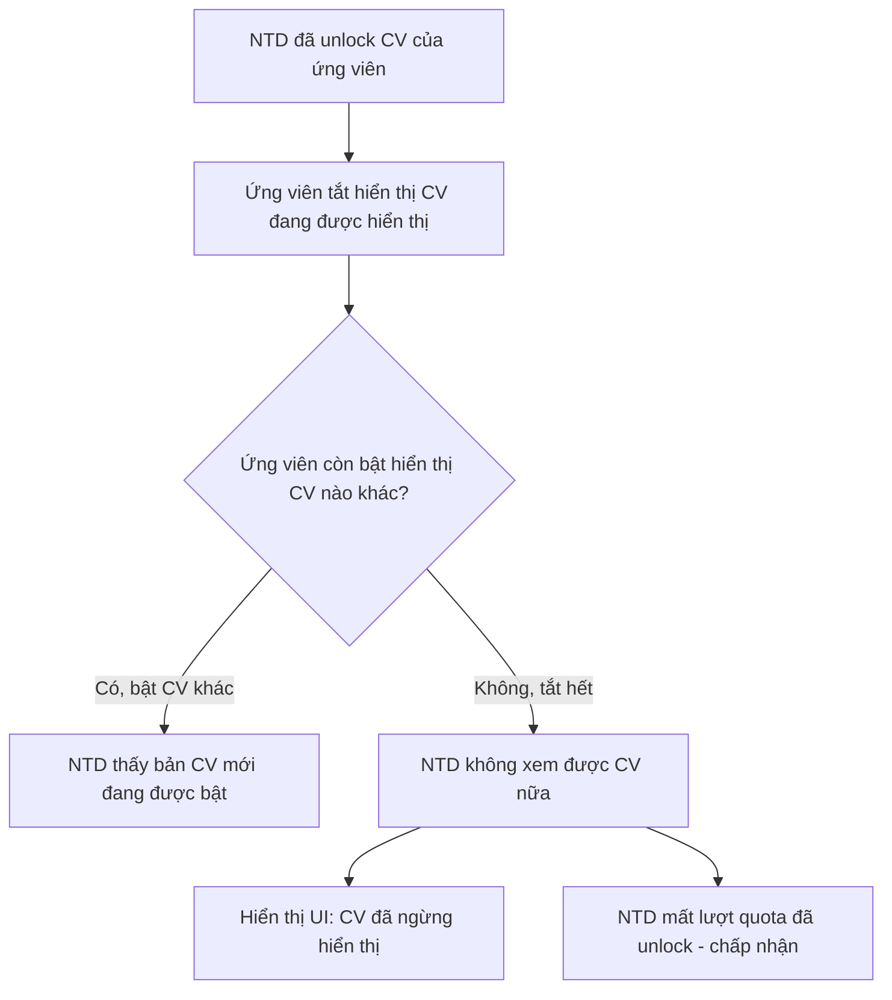
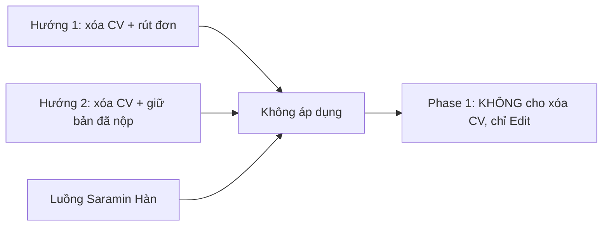

# Xóa tài khoản & Xóa CV – Quy tắc áp dụng Phase 1

> **Phạm vi:** tài liệu mô tả **hệ thống đang làm cho Phase 1** (go-live 21/11/2026), không phải các đề xuất cho giai đoạn sau.
> **Nguyên tắc Phase 1:** hạn chế thay đổi Policy nhiều nhất có thể. Vì vậy **ứng viên KHÔNG được xóa CV** ở Phase 1. Các phương án xóa CV đã từng đề xuất được ghi ở mục 5 để tham khảo, **không áp dụng**.

| Thông tin | Nội dung |
|---|---|
| Nguồn quyết định | Call 04/11/2026 (16:55–17:28): Saramin VN (chị Huyền, anh Danh) – BurningBros (chị Thu, Nguyên) |
| Cập nhật luồng xóa tài khoản | Ghi nhận ngày 06/11/2026 |
| Ngày cập nhật tài liệu | 10/11/2026 |
| Trạng thái | Xóa CV: **đã chốt**. Xóa tài khoản: **đã chốt**, còn 2 điểm cần xác nhận lại (mục 6) |

---

## 1. Tóm tắt nhanh

| Hành động của ứng viên | Phase 1 có cho phép? | Ảnh hưởng chính |
|---|---|---|
| **Xóa tài khoản** | ✅ Có | Tài khoản bị vô hiệu hóa ngay; NTD không còn xem được CV (kể cả đơn đã nộp và CV đã unlock); NTD nhận email thông báo; dữ liệu cá nhân bị xóa vĩnh viễn sau 72 giờ |
| **Xóa CV** | ❌ Không | Ẩn nút Delete. Ứng viên chỉ **Edit** CV. Đơn ứng tuyển và Talent Pool không bị ảnh hưởng bởi thao tác xóa |
| **Tắt hiển thị CV với NTD** | ✅ Có | NTD đã unlock: còn thấy CV nếu ứng viên đang bật 1 CV khác; không thấy nữa nếu ứng viên tắt hết |

---

## 2. Xóa tài khoản (Delete Account)

### 2.1 Luồng xử lý

### 2.2 Dòng thời gian

### 2.3 Ảnh hưởng theo từng khu vực

| Khu vực | Trước khi xóa | Sau khi ứng viên xác nhận xóa |
|---|---|---|
| **Tài khoản ứng viên** | Hoạt động | Bị vô hiệu hóa ngay, không đăng nhập được |
| **Email gửi ứng viên** | Theo lịch (JS 1–7) | Ngừng **ngay** khi xác nhận xóa (không đợi hết 72 giờ). Chỉ gửi JS 8 |
| **Đơn ứng tuyển (Candidate Management của NTD)** | NTD xem được CV trong đơn | Dòng ứng tuyển chuyển sang UI **"Tài khoản đã bị xóa"**; NTD **không xem được CV** nữa |
| **Talent Pool** | Ứng viên hiển thị nếu đang bật CV | Ứng viên bị ẩn khỏi Talent Pool |
| **CV NTD đã unlock** | NTD xem được CV | NTD **không xem được** nữa; **NTD mất lượt quota** đã dùng để unlock (đã chấp nhận) |
| **Thông báo cho NTD** | – | **CO 11**: ứng viên đã xóa tài khoản, NTD vui lòng xóa hồ sơ ứng viên khỏi hệ thống/thư mục của công ty |
| **Dữ liệu cá nhân** | Lưu trữ | Xóa vĩnh viễn sau **72 giờ** kể từ lúc xác nhận |

### 2.4 Email liên quan

| Mã | Tên | Người nhận | Thời điểm |
|---|---|---|---|
| **JS 8** | Xóa tài khoản thành công | Ứng viên | Ngay khi xác nhận xóa |
| **CO 11** | Ứng viên đã xóa tài khoản | Các công ty ứng viên **đã ứng tuyển** | Ngay khi xác nhận xóa |
| – | (không có) | – | Thời điểm xóa dữ liệu sau 72 giờ: **không gửi email** |

> ⚠️ **Lưu ý nội dung JS 8:** bản hiện tại có câu "Các đơn ứng tuyển bạn đã thực hiện đã được rút lại". Theo quyết định 04/11, đơn ứng tuyển **không bị rút** mà hiển thị trạng thái **"Tài khoản đã bị xóa"** phía NTD. Câu này cần sửa (xem mục 6).

---

## 3. Xóa CV (Delete CV) – KHÔNG cho phép ở Phase 1

### 3.1 Quyết định

- Chốt ngày **04/11/2026** bởi Saramin VN (chị Huyền, anh Danh).
- Lý do:
  - Hệ thống Saramin hiện tại **cũng không cho ứng viên xóa CV**.
  - Giữ nguyên Policy, tránh phải sửa Policy trước go-live.
  - Tránh mất dữ liệu đơn ứng tuyển và CV NTD đã unlock.
- Mọi mở rộng (ví dụ cho xóa CV, xử lý khi vượt giới hạn) để **Phase 2**.

### 3.2 Ứng viên được làm gì với CV

| Thao tác | Saramin CV | Upload CV (PDF/DOC) |
|---|---|---|
| Edit | ✅ Sửa trực tiếp nội dung | ✅ Thay file mới (replace), sửa tên CV, tổng số năm kinh nghiệm |
| Download | ✅ | ✅ |
| Bật/tắt hiển thị với NTD | ✅ | ✅ |
| **Delete** | ❌ Ẩn nút | ❌ Ẩn nút |
| Chuyển đổi giữa 2 loại | ❌ | ❌ |

### 3.3 Giới hạn số lượng CV

Vì không cho xóa và không chuyển đổi được giữa 2 loại CV, giới hạn được **tách riêng**:

| Loại CV | Tối đa |
|---|---|
| Saramin CV | **20** |
| Upload CV | **20** |
| **Tổng** | **40 CV / ứng viên** |

- Khi chạm giới hạn của một loại: ứng viên **không tạo/upload thêm** loại đó, phải **Edit** CV cũ.
- Trường hợp vượt ngưỡng (edge case): đưa vào enhancement **Phase 2**.

### 3.4 Ảnh hưởng

Vì không có thao tác xóa CV, các khu vực sau **không bị ảnh hưởng**:

| Khu vực | Kết quả |
|---|---|
| Đơn ứng tuyển | Giữ nguyên, NTD và Admin xem CV đã nộp như bình thường |
| Talent Pool | Chỉ thay đổi khi ứng viên **bật/tắt hiển thị** (mục 4), không có trường hợp CV biến mất do bị xóa |
| CV NTD đã unlock | Không bị mất do xóa CV |
| Email | **Không có email** cho thao tác xóa CV. CO 10 chỉ dùng cho trường hợp ứng viên **rút đơn ứng tuyển** |
| Policy | Không cần thêm điều khoản mới cho Phase 1. Nội dung **xóa CV trong Policy 09-21** (rút đơn + gửi mail NTD) **không còn áp dụng** vì ứng viên không xóa được CV; Saramin VN rà soát và gỡ/ghi chú mục này (xem mục 6, không chặn go-live) |

---

## 4. Ẩn CV trên Talent Pool sau khi NTD đã unlock

Đây là trường hợp duy nhất còn lại làm NTD mất quyền xem CV đã unlock (ngoài xóa tài khoản).

| Trường hợp | NTD đã unlock sẽ thấy |
|---|---|
| Ứng viên tắt CV 1 và **bật CV 2** (còn ít nhất 1 CV đang hiển thị) | Bản **CV đang được bật** (mới nhất) |
| Ứng viên **tắt hết** tất cả CV | **Không xem được nữa**, hiển thị UI CV đã ngừng hiển thị; NTD mất quota |

---

## 5. Các phương án xóa CV đã đề xuất (KHÔNG áp dụng Phase 1)

Các phương án dưới đây đã được thảo luận trước ngày 04/11 nhưng **không áp dụng**. Chỉ giữ lại để tham khảo khi làm Phase 2.

| Phương án | Nội dung | Trạng thái |
|---|---|---|
| **Hướng 1** | Xóa CV = rút các đơn ứng tuyển dùng CV đó + gửi email cho NTD (CO 10). Đây cũng là nội dung đang ghi trong Policy 09-21 | ❌ Không áp dụng |
| **Hướng 2** | Giữ bản CV tại thời điểm ứng tuyển, đơn không bị ảnh hưởng, không gửi email. Talent Pool – Phương án A: NTD đã unlock vẫn xem bản cuối; NTD chưa unlock (kể cả đã lưu) không thấy nữa | ❌ Không áp dụng |
| **Luồng Saramin Hàn Quốc** | Không cho xóa CV đã dùng để ứng tuyển | ❌ Không dùng làm căn cứ. Phase 1 theo Policy Việt Nam, và **không cho xóa CV nào** |

---

## 6. Điểm còn cần xác nhận

| # | Nội dung | Ghi chú |
|---|---|---|
| 1 | **Xóa tài khoản – NTD có còn thấy CV không?** Quyết định 04/11: NTD **không xem được** CV (đơn đã nộp và CV đã unlock). Saramin VN có nhắc tới một rule khác: NTD vẫn thấy CV nhưng **ẩn thông tin định danh** (tên, email, SĐT, địa chỉ, link MXH) | Cần Saramin VN xác nhận bản nào là bản chốt cuối |
| 2 | **Nội dung JS 8**: bỏ câu "Các đơn ứng tuyển đã được rút lại do việc xóa tài khoản", thay bằng nội dung đúng với mục 2 | Sửa nội dung email |
| 3 | **Policy 09-21**, mục xóa CV đang ghi "rút đơn + gửi mail NTD" (Hướng 1) | Mục này **không còn áp dụng** ở Phase 1 (không có thao tác xóa CV). Saramin VN gỡ hoặc ghi chú "chưa áp dụng" trong Policy. Hệ thống **không** làm theo nội dung này. Không chặn go-live |
| 5 | **Build cũ chưa theo quyết định 04/11:** build 08/10 rút các đơn đang xử lý khi xóa tài khoản; ảnh 15/10 vẫn có nút Delete CV, ghi chú "không giới hạn CV" và chưa có màn thay file (replace). Tài liệu `docs/resume-management-create-cv.md` cũng còn ghi không giới hạn CV + menu Delete | Dev cập nhật build theo mục 2–4; cập nhật lại tài liệu nguồn. Việc **có rút đơn khi xóa tài khoản hay không** phụ thuộc điểm #1–#2 |
| 4 | Giới hạn **20 + 20 CV**: chờ dev xác nhận không ảnh hưởng hệ thống | Nếu không được thì dùng 10 + 10 |

---

## 7. Thuật ngữ

| Thuật ngữ | Ý nghĩa |
|---|---|
| UV | Ứng viên (Jobseeker) |
| NTD | Nhà tuyển dụng (Employer) |
| Talent Pool | Kho CV ứng viên mà NTD tìm kiếm và unlock |
| Unlock | NTD dùng quota để mở khóa thông tin CV ứng viên trên Talent Pool |
| Saramin CV | CV tạo trực tiếp trên form của Saramin |
| Upload CV | CV dạng file (PDF/DOC) ứng viên tải lên |
| JS 8 | Email gửi ứng viên khi xóa tài khoản thành công |
| CO 10 | Email gửi NTD khi ứng viên rút đơn ứng tuyển |
| CO 11 | Email gửi NTD khi ứng viên xóa tài khoản |
